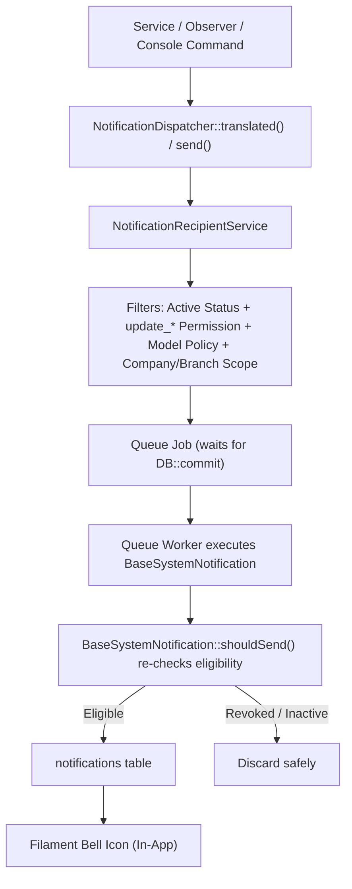
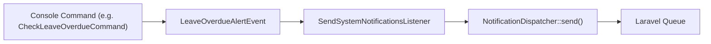

# Unified Notification System — Developer Usage Guide

This guide explains how to add and trigger notifications across **Orcal** in simple steps with **zero boilerplate** (no dedicated Notification, Event, or Listener classes required for routine alerts).

---

## Why This Approach? (Architecture Decision)

### The Problem: Boilerplate & Inconsistent Scoping
In enterprise ERP systems with dozens of modules, creating separate `Event`, `Listener`, and `Notification` classes for every single alert causes **file explosion** (dozens of redundant files). Even worse, distributing recipient queries across controllers, observers, and commands leads to **security bugs** (e.g., users receiving alerts for companies they don't belong to, or users with view-only permissions receiving operational alerts).

### The Solution: Centralized Notification Engine
Orcal uses a unified **Notification Engine** (`NotificationDispatcher` + `NotificationRecipientService` + `BaseSystemNotification`):
- **Zero Boilerplate:** Declare translation keys and dispatch in one line — no need to create new Event, Listener, or Notification PHP classes for standard alerts.
- **Centralized Content in Translations:** All strings live in `lang/{ar,en}/notifications.php`.
- **Automatic Scoping & Permission Guard:** Recipient resolution strictly enforces active account status, record-level `update_*` permissions, model policies, and company/branch boundaries.
- **Queue-Powered Transaction Safety:** Dispatched jobs wait for database commit (`$afterCommit = true`) and re-verify recipient eligibility at worker execution time.
- **Database Only (Filament Bell):** Built-in compatibility with the Filament Bell icon; SMS is centrally disabled.

---

## System Architecture



---

## Step 1: Define Translations

All notification strings are localized in both Arabic and English.

Open:
- `lang/ar/notifications.php`
- `lang/en/notifications.php`

Define your notification keys with title and body. You can group them by domain (e.g., `tickets`, `service`, `tasks`, `debts`):

### Arabic (`lang/ar/notifications.php`):
```php
return [
    'service' => [
        'completed_title' => 'اكتملت معاملة الخدمة',
        'completed_body'  => 'معاملة الخدمة رقم :number اكتملت بنجاح.',
    ],
];
```

### English (`lang/en/notifications.php`):
```php
return [
    'service' => [
        'completed_title' => 'Service Transaction Completed',
        'completed_body'  => 'Service transaction #:number has been completed successfully.',
    ],
];
```

> **Note:** Any parameter prefixed with `:` (e.g., `:number`, `:code`, `:employee_name`) will be dynamically replaced when dispatching.

---

## Step 2: Configure Channels (Database Only)

Open `config/notifications.php`.

By default, all notifications are delivered via **database only** (`'default_channels' => ['database']`), and SMS is strictly disabled centrally:

```php
return [
    'default_channels' => ['database'],

    'sms' => [
        'enabled'  => env('NOTIFICATIONS_SMS_ENABLED', false),
        'provider' => env('NOTIFICATIONS_SMS_PROVIDER', 'mock'),
    ],
];
```

- **`database`**: Stores the notification in the standard `notifications` table. Visible instantly in the Filament Bell icon.
- **`sms`**: Blocked centrally at both `SmsChannel` and `SmsService`. Calling SMS directly returns `false` safely without external API calls or fees.

---

## Step 3: Dispatch the Notification

### Guiding Rule (When to use Domain Service vs Direct Dispatcher):
1. **Multi-Event Domains (e.g., Tickets, Operations):** Keep notification logic encapsulated in dedicated services (e.g., `TicketNotificationService`, `OperationsNotificationService`).
2. **Single-Alert Modules & Observers:** Call `NotificationDispatcher` directly in one line.

---

### Option A: Domain Notification Services (Recommended for Modules)

Encapsulate notification dispatching in your domain service (e.g., `app/Services/OperationsNotificationService.php`):

```php
namespace App\Services;

use App\Models\ServiceTransaction;
use App\Services\Notifications\NotificationDispatcher;

class OperationsNotificationService
{
    public static function notifyCompleted(ServiceTransaction $transaction): void
    {
        NotificationDispatcher::translated(
            record: $transaction,
            eventKey: 'ServiceTransactionCompleted',
            titleKey: 'notifications.service.completed_title',
            bodyKey: 'notifications.service.completed_body',
            parameters: ['number' => $transaction->transaction_number],
            icon: 'heroicon-o-check-circle',
            color: 'success',
            excludeUserIds: array_filter([auth()->id()]), // Optional: don't notify the actor
        );
    }
}
```

Now from your controller, action, or observer, trigger it in **exactly one line**:
```php
OperationsNotificationService::notifyCompleted($transaction);
```

---

### Option B: Direct Dispatching via `NotificationDispatcher`

#### 1. Quick Dispatch with Auto-Translations
```php
use App\Services\Notifications\NotificationDispatcher;

NotificationDispatcher::translated(
    record: $record, // e.g., Debt, Leave, Ticket, Company, Employee
    eventKey: 'DebtDueAlert',
    titleKey: 'notifications.events.DueDateReminder.database.title',
    bodyKey: 'notifications.events.DueDateReminder.database.body',
    parameters: ['code' => $debt->id, 'employee_name' => $employee->name],
    icon: 'heroicon-o-banknotes',
    color: 'warning',
);
```

#### 2. Exclude the User Who Performed the Action
To prevent a user from receiving an in-app notification about an action they performed themselves:
```php
NotificationDispatcher::translated(
    record: $taskAssignment,
    eventKey: 'TaskAssigned',
    titleKey: 'tasks.notifications.new_assignment_title',
    bodyKey: 'tasks.notifications.new_assignment_body',
    parameters: ['number' => $taskAssignment->transaction_number],
    excludeUserIds: [auth()->id()],
);
```

#### 3. Custom Notification Instance (Explicit Action URL / Payload)
```php
use App\Notifications\BaseSystemNotification;
use App\Services\Notifications\NotificationDispatcher;

NotificationDispatcher::send(
    record: $ticket,
    notification: new BaseSystemNotification(
        eventKey: 'TicketAssigned',
        customTitle: 'تم تعيين تذكرة جديدة',
        customMessage: "تم تعيين التذكرة رقم #{$ticket->ticket_number} إليك.",
        actionUrl: route('filament.admin.resources.tickets.view', ['record' => $ticket]),
        icon: 'heroicon-o-ticket',
        color: 'primary',
    ),
);
```

---

## Step 4: Existing Event-Based Alerts (Scheduled Commands)

For scheduled background checks (Iqama expiries, commercial licenses, leave overdues), events implement `NotificationEventInterface`:



### Event Contract Methods:
| Method | Description |
| --- | --- |
| `getRecord(): ?Model` | The target model (used by `NotificationRecipientService` for authorization). |
| `getEventKey(): string` | The event key matching `config/notifications.php`. |
| `getPlaceholders(): array` | Dynamic values for template string replacement (`{placeholder}`). |
| `getActionUrl(): ?string` | Target Filament view/edit URL (or `null` for auto-resolution). |
| `getCustomMessage(): ?string` | Optional custom body, or `null` to use config/lang templates. |

---

## Key Built-in Architectural Guarantees

1. **Transaction Safety (`$afterCommit = true`):**
   Notifications are automatically queued and dispatched **only after** active database transactions commit successfully (`DB::commit`). If a transaction rolls back, no notification is queued or sent.

2. **Strict Multi-Tenant & Permission Scoping:**
   `NotificationRecipientService` ensures notifications are only dispatched to:
   - **Active accounts:** `status === 'active'`.
   - **Update Permission:** Holds the required `update_*` permission (e.g., `update_debt`, `update_leave`). View-only permissions never receive operational alerts.
   - **Policy Allowed:** `Gate::allows('update', $record)` returns `true`.
   - **Scoped Boundaries:** Super Admins receive globally; Owners receive strictly for their owned companies; normal users receive strictly within their authorized companies and branches.

3. **Double-Check on Worker Execution (`shouldSend`):**
   Before saving the notification to the database, `BaseSystemNotification::shouldSend()` re-verifies that the record still exists and that the recipient's permissions and active status have not been revoked while sitting in the queue.

4. **Filament Bell Compatibility Out-of-the-box:**
   Every database notification automatically generates a payload fully compliant with Filament Bell (`title`, `body`, `icon`, `iconColor`, `actions`, `format => 'filament'`).

5. **Retry & Backoff Strategy:**
   Background notification jobs feature automatic retry configurations (`$tries = 3`, `$backoff = 10`, `$timeout = 60s`).

---

## Testing & Verification Commands

```bash
# 1. Clear application and view cache
php artisan optimize:clear

# 2. Run automated feature tests
php artisan test --filter=NotificationsRefactorTest

# 3. Run scheduled notification checks
php artisan debts:check-due-dates
php artisan leaves:check-overdue
php artisan violations:check-deadlines

# 4. Process queued notifications
php artisan queue:work --stop-when-empty
```
