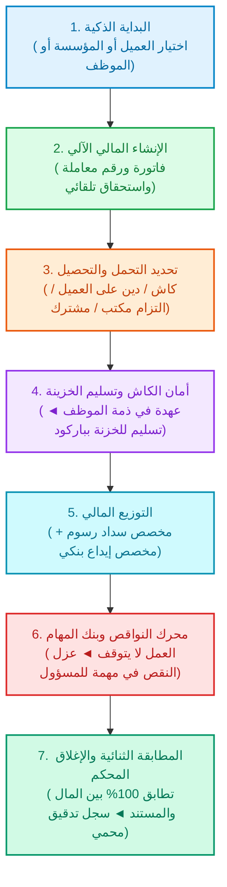

# وثيقة ومخطط «المحرك المالي والتشغيلي الموحد»
### الدليل الشامل لكافة العمليات المالية والتشغيلية في المنشأة (للاعتماد والمراجعة)

---

## 🌟 1. الفكرة الجوهرية (المختصر المفيد)

في الأنظمة التقليدية، تسجيل المعاملة في شاشة، والفاتورة في شاشة ثانية، واستلام الكاش في شاشة ثالثة، وسداد الرسوم أو الإيداع البنكي في شاشات أخرى، مما يسبب ضياع الوقت وتشتت الأرقام.

**الهدف من «المحرك المالي الموحد»:**  
دمج المنظومة المالية والتشغيلية بالكامل في **مسار واحد ذكي ومترابط**:  
> **«أي عملية مالية أو خدمة تنشئ ماليتها وفاتورتها تلقائياً، والعمل يستمر ولا يتعطل إذا تأخر أي طرف، والنظام يعزل النواقص في مهام تلقائية، ولا تُقفل العملية نهائياً إلا بعد مطابقة الريال والورقة 100% مع حفظها في سجل تدقيق محمي لا يُحذف».**

---

## 🌐 2. نطاق التطبيق الشامل (والاستثناء الوحيد)

يطبق هذا المحرك المالي والتشغيلي على **كافة الأنشطة والعمليات المالية في المنشأة دون استثناء**، وفق الجدول التالي:

| # | القطاع المالي المشمول | أمثلة العمليات داخل النظام | كيف يتعامل معها المحرك الموحد؟ |
| :-: | :--- | :--- | :--- |
| **1** | **خدمات ومعاملات العملاء** | الإقامات، رخص العمل، الجوازات، رخص البلديات، السجلات، التأشيرات، التأمين. | إنشاء فوري، فاتورة آلية، عهدة كاش بالباركود، وسداد رسوم مع إثباتات. |
| **2** | **الفواتير والمصروفات التشغيلية** | فواتير الكهرباء، الاتصالات، المشتريات، الضيافة، الصيانة، المواد المكتبية. | صرف من الخزينة، إرفاق الفاتورة الضريبية، ومطابقة المبلغ والمستند. |
| **3** | **عقود الإيجارات والالتزامات** | إيجارات مقرات الفروع، دفعات الملاك الدورية، الخدمات السنوية. | جدولة الدفعات، تنبيهات الاستحقاق، وسند صرف خزانة تلقائي. |
| **4** | **مسيرات الرواتب والتحصيل** | رواتب الموظفين الشهرية، البدلات، وتحصيل مستحقات التشغيل من الموظف. | صرف كاش بالخزينة بباركود أو إيداع بنكي مع تتبع صافي الاستحقاق. |
| **5** | **المخالفات والغرامات** | المخالفات المرورية، مخالفات البلدية، رسوم التأخير الحكومية. | توجيه للمسؤول، سداد مع إرفاق إيصال السداد، وإغلاق المخالفة. |
| **6** | **الديون والتحصيلات العامة** | مديونيات العملاء الآجلة، الأقساط، وتحصيل الشيكات المتأخرة. | قيد فوري للدين، تنبيهات استحقاق آلية، وسند قبض فوري عند التحصيل. |

---

> ### ⛔ الاستثناء المؤكد والوحيد:
> **«الصناديق المالية المستقلة» (صندوق الأصول، صناديق القروض، وصناديق الجمعيات):**  
> تظل مستقلة تماماً كما هي بحساباتها وتقاريرها الخاصة، ولا يشملها هذا المسار الموحد للحفاظ على هيكلها المحاسبي الخاص.

---

## 🔄 3. دورة الحياة الموحدة للمال والمستند (7 محطات رئيسية)

كل عملية مالية أو خدمة داخل النظام تعبر من خلال المسار الموحد الآتي:



### تفصيل المحطات السبع:
1. **البداية الذكية:** يختار المستخدم العميل أو المؤسسة، أو يختار الموظف التابع للمؤسسة مباشرة؛ فيستنتج النظام كافة البيانات التابعة آلياً ويمنع تكرار الإدخال.
2. **الإنشاء المالي الآلي:** فور اختيار الخدمة، يولد النظام الفاتورة، ورقم المعاملة التسلسلي، والمبالغ المتوقعة (رسوم الجهة + أتعاب المكتب).
3. **تحديد التحمل:** (العميل دفع نقداً / دين مستحق على العميل / التزام تحمله المكتب / تكلفة مشتركة بنسب محددة).
4. **أمان الكاش بالباركود:** المبلغ الذي يستلمه الموظف نقداً يدخل فوراً كـ **«عهدة»** بذمته، ويولد النظام باركوداً متغيراً للمعاملة؛ وبمجرد أن يمسحه أمين الخزنة، يُقيد المبلغ في الخزنة وتسقط العهدة عن الموظف فوراً.
5. **التوزيع المالي:** النظام يفرز المبلغ داخل الخزينة تلقائياً:
   - مبلغ مخصص لسداد الرسوم (يذهب لمسؤول السداد).
   - مبلغ مخصص للإيداع في البنك (يذهب لمسؤول الإيداع).
   - أي فائض يظل في الخزينة كرصيد مرتبط بالعملية لحساب العميل.
6. **محرك النواقص (العمل لا يتعطل):** لو تأخر رفع إيصال سداد، أو تأخر إيداع بنكي، تستمر المعاملة طبيعياً، ويعزل النظام النقص في **«مهمة متابعة خاصة»** لمسؤول ذلك النقص فقط دون تعطيل باقي الفريق.
7. **المطابقة والإغلاق وسجل التدقيق:** عند اكتمال المستندات ومطابقة كل ريال بإيصاله الصحيح، تُقفل المعاملة نهائياً وتُحفظ في **سجل تدقيق دائم ومحمي من الحذف والتعديل** (`Audit Log`).

---

## 🎬 4. سيناريو عملي بالأرقام (كيف تسير المعاملة واقعياً؟)

لنفترض أن عميلاً حضر للمكتب لتجديد **«إقامة موظف»** بقيمة إجمالية **1,500 ريال** (1,000 ريال رسوم حكومية للجوازات + 500 ريال أتعاب المكتب):

```
┌─────────────────┐       ┌─────────────────┐       ┌─────────────────┐       ┌─────────────────┐
│ الموظف يستلم    │       │ توريد للخزنة    │       │ الخزينة توزع    │       │ السداد والإيداع │
│ 1,500 كاش       │ ────► │ بمسح الباركود   │ ────► │ المبلغ آلياً    │ ────► │ ورفع الإثباتات  │
│ (عهدة على الموظف)│       │ (العهدة تصبح 0) │       │ (1000سداد/500بنك)│       │ (تطابق تام 100%)│
└─────────────────┘       └─────────────────┘       └─────────────────┘       └─────────────────┘
```

1. **التحصيل:** يستلم الموظف 1,500 ريال؛ يظهر في حسابه فوراً: **عهدة نقدية = 1,500 ريال**، ويصل إشعار فوري لأمين الخزنة.
2. **التوريد بالباركود:** يذهب الموظف لأمين الخزنة ومعه الكاش ويفتح شاشته التي تولد **باركود المعاملة**؛ أمين الخزنة يمسح الباركود:
   - عهدة الموظف تصبح **(0 ريال)**.
   - رصيد الخزينة يرتفع بـ **(+1,500 ريال)**.
   - تنتقل المسؤولية رسمياً من ذمة الموظف إلى الخزنة.
3. **التوزيع داخل الخزنة:**
   - **1,000 ريال:** تخصص لـ «مسؤول السداد» لسداد الجوازات.
   - **500 ريال:** تخصص لـ «مسؤول الإيداع» لتوريدها لحساب البنك.
4. **السداد والإيداع والمطابقة:**
   - مسؤول السداد يسدد الـ 1,000 ريال بالجوازات ويرفع صورة إيصال السداد.
   - مسؤول الإيداع يودع الـ 500 ريال في البنك ويرفع إشعار الإيداع البنكي.
   - النظام يطابق: (خدمة نُفذت + 1,000 ريال بإيصال سداد صحيح + 500 ريال بإشعار بنكي = **تطابق تام 100%**) ← تُقفل المعاملة وتتحول إلى «مكتملة ومطابقة».

---

## 🚦 5. التعامل مع الحالات غير الاعتيادية (لماذا لا يتعطل العمل؟)

صُمم النظام ليتعامل مع كافة الظروف الطارئة بمرونة فائقة:

* **الحالة الأولى — العميل دفع جزءاً وتأخر بالباقي:**  
  الخدمة لا تتوقف؛ يسجل النظام ما تم استلامه كاش، والمبلغ المتبقي يُقيد تلقائياً كـ **«دين مستحق على العميل»** مع تحديد تاريخ استحقاق للمتابعة.
* **الحالة الثانية — الموظف سدد رسوماً حكومية من جيبه الخاص:**  
  لا تضيع حقوق الموظف؛ يُسجل المبلغ فوراً كـ **«مستحق للموظف»**، وفور رفع إيصال السداد واعتماده يخرج له سند صرف نقدي فوري لتعويضه.
* **الحالة الثالثة — نسيان أو تأخر رفع إيصال السداد:**  
  الموظف الذي استلم الكاش وورده للخزنة أنهى مسؤوليته كاملة ولا يتحمل أي تأخير؛ النظام يعزل النقص ويفتح **مهمة تلقائية وتنبيه** في لوحة «مسؤول السداد» فقط لإلزامه برفع الإشعار.
* **الحالة الرابعة — إيداع بنكي واحد يضم كاش عدة معاملات (إيداع مجمع):**  
  يتيح النظام لمسؤول الإيداع توريد دفعة بنكية واحدة بمبلغ كبير (مثلاً: 10,000 ريال تضم 10 خدمات مختلفة)، مع بقاء كل جزء منسوباً لعمليته وعميله بالتفصيل داخل النظام.
* **الحالة الخامسة — تحويل بنكي وصل الحساب وغير معروف لمن يتبع (مبلغ معلق):**  
  يُحفظ المبلغ في قسم **«مبالغ معلقة»** ولا يدخل في أرباح أي عملية حتى يتم التعرف على العميل وربطه بالمعاملة الصحيحة بعد الاعتماد.

---

## 📊 6. شاشة المراقبة اللحظية للمدير (الأرصدة الأربعة والمؤشر العام)

تظهر للإدارة شاشة تحكم مركزية تعرض 4 بطاقات أرصدة حية ومؤشر عام:

```
┌─────────────────────────────────┐       ┌─────────────────────────────────┐
│           رصيد العميل           │       │           رصيد الموظف           │
│ • المستحق عليه                  │       │ • كاش العهدة اللي في جيبه       │
│ • ما دفعه فعلياً                │       │ • ما ورده للخزنة فعلياً         │
│ • المتبقي / الديون والآجال      │       │ • مستحقاته لو دفع من جيبه الخاص │
└─────────────────────────────────┘       └─────────────────────────────────┘
┌─────────────────────────────────┐       ┌─────────────────────────────────┐
│           رصيد الخزنة           │       │           رصيد المكتب           │
│ • الكاش الفعلي المتوفر حالياً   │       │ • التزامات تحملها المكتب        │
│ • المحجوز لسداد الرسوم          │       │ • ما تم سداده فعلياً            │
│ • المجهز للإيداع البنكي         │       │ • المتبقي كالتزام قائم          │
└─────────────────────────────────┘       └─────────────────────────────────┘
                                   ▼
          ┌─────────────────────────────────────────────────┐
          │               المؤشر المالي العام               │
          │ • المتوقع   • الفعلي المدفوع بإثبات   • المتبقي │
          │ • المعلق    • بانتظار الاعتماد        • المتأخر │
          └─────────────────────────────────────────────────┘
```

---

## 👥 7. الأدوار الستة وتوزيع الصلاحيات

تم ضبط النظام ليمنع تضارب المصالح ويوفر مرونة كاملة للمكاتب الصغيرة والكبيرة:
1. **الموظف (موظف الخدمة/الاستقبال):** إنشاء الخدمة، استلام الكاش، وتسليمه للخزنة بالباركود.
2. **أمين الخزنة:** فحص باركود التسليم، استلام النقد، تسليم مخصصات السداد ومبالغ الإيداع.
3. **مسؤول السداد:** سداد الرسوم الحكومية أو الموردين ورفع صورة إثبات السداد.
4. **مسؤول الإيداع:** توريد المبالغ لحسابات البنك ورفع إشعارات الإيداع البنكي.
5. **المشرف:** اعتماد الإلغاء، التصحيحات، تعويضات الموظفين، وفروقات الأسعار.
6. **الإدارة:** الإشراف العام، متابعة مؤشرات الأداء، والبت في الحالات الاستثنائية.

*(ملاحظة: النظام يتيح للمكتب الصغير دمج الأدوار لنفس الشخص مثل الجمع بين الخزنة والإيداع، أو فصلها تماماً في المكاتب الكبيرة).*

---

## ✍️ 8. نموذج الاعتماد النهائي المباشر (خيارات محددة للاختيار)

لتأكيد انطلاق العمل فوراً، يرجى التكرم باختيار الخيار الأنسب لطبيعة عملكم في كل بند:

---

### [1] طريقة تسليم الكاش للخزنة
* **[ الخيار أ — الموصى به ]:** الموظف يُظهر باركود المعاملة (QR Code) من شاشته أو جواله، وأمين الخزنة يمسحه بالماسح أو كاميرا الجوال + خيار كتابة رقم المعاملة يدوياً للبحث الفوري والتأكيد.
* **[ الخيار ب ]:** الاعتماد على إدخال رقم المعاملة يدوياً فقط بدون باركود.

---

### [2] سداد الرسوم الحكومية وإثباتاتها
* **[ الخيار أ — الموصى به ]:** السداد يتم يدوياً من طرفكم (عبر حسابكم البنكي أو بطاقة مدى الخاصة بالمكتب)، ويلزم النظام مسؤول السداد برفع صورة/ملف PDF لإيصال السداد لتوثيق العملية وإغلاقها.
* **[ الخيار ب ]:** ربط إلكتروني مباشر (API) مع بوابات الدفع (يتطلب اشتراكات وتراخيص خاصة بالبوابات).

---

### [3] تعويض الموظف إذا دفع رسوماً من ماله الخاص
* **[ الخيار أ — الموصى به ]:** يخرج له سند صرف نقدي فوري من الخزينة فور اعتماد المشرف لإيصال السداد.
* **[ الخيار ب ]:** تُقيد القيمة في حسابه وتُصرف له مجمعة مع راتب نهاية الشهر.

---

### [4] الإيداع البنكي المجمع
* **[ الخيار أ — الموصى به ]:** نعم، تفعيل ميزة «الإيداع المجمع» لتوريد كاش عدة خدمات في دفعة بنكية واحدة نهاية اليوم.
* **[ الخيار ب ]:** لا نحتاجها، نفضل أن يرتبط كل إيداع بنكي بمعاملة واحدة فقط بشكل منفصل.

---

### [5] مرونة الأدوار في الفروع
* **[ الخيار أ — الموصى به ]:** السماح بدمج الأدوار حسب حاجة المكتب (مثلاً: أمين الخزنة هو نفسه من يودع في البنك).
* **[ الخيار ب ]:** فصل صارم للأدوار؛ لا يجوز لأي موظف الجمع بين دورين.

---

> 🤝 **بمجرد اختياركم للخيار المفضل أو تزويدنا بأي ملاحظة إضافية، سيبدأ الفريق البرمجي مباشرة في التنفيذ.**

