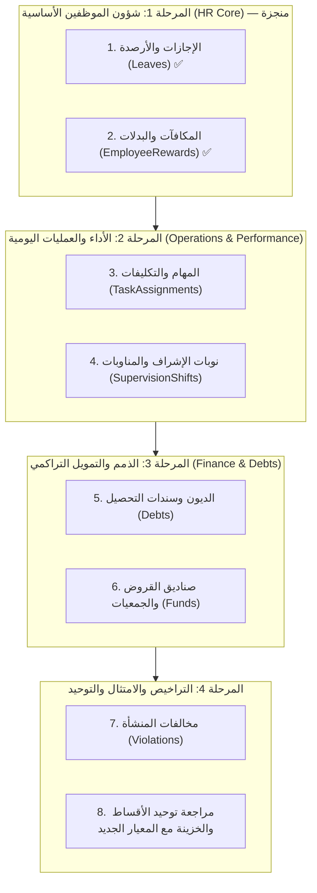

# دراسة وحصر الشاشات المرشحة لتطبيق نمط «الملخص التجميعي والتفاصيل» (المطبق في الحضور والانصراف)

> **تاريخ الإعداد:** 2026-11-10  
> **المرجعية:** نمط الحضور والانصراف المعتمد في `docs/plans/ATTENDANCE_EMPLOYEE_FIRST_AND_UX_UNIFICATION_PLAN.md` و [دليل الحضور](../modules/ATTENDANCE.md).  
> **الهدف:** حصر وتصنيف جميع شاشات النظام التي تعتمد حالياً على «جداول حركات مسطحة» وتحديد الشاشات التي تحتاج التحول إلى نمط «الكيان أولاً + بطاقات KPI + نافذة التفاصيل التفاعلية + فصل السجل الخام»، مع ترتيب أولوياتها وخطة تنفيذها.  
> **تحديث الحالة:** 2026-11-11 — تم التحقق من الكود المحلي؛ خمس شاشات تطبق النمط فعلياً (الحضور، المكافآت، الإجازات، الأقساط، الخزينة)، والمتبقي موضّح في [القسم 1.1](#11-الحالة-الموثقة-على-الكود-المحلي-2026-11-11).

---

## 1. ما هو النمط الذي تم تطبيقه في «الحضور والانصراف»؟

في شاشة الحضور والانصراف تم الانتقال من شاشة تقليدية تعرض جدولاً مسطحاً لكل بصمة/حركة فردية إلى **معمارية تفاعلية رباعية الطبقات (4-Tier Architecture)**:

```
┌────────────────────────────────────────────────────────────────────────┐
│ 1) بطاقات المؤشرات (KPI Cards)                                        │
│    إحصائيات إجمالية محسوبة على مستوى الفلاتر والمدى الزمني المحدد       │
├────────────────────────────────────────────────────────────────────────┤
│ 2) شريط الفلاتر الموحد (<x-filter-bar> أو محدد الفترات والشهور)         │
│    فلاتر الشهر (تثبيت اليوم الأول)، الشركة، الفرع، حالة الموظف، والبحث │
├────────────────────────────────────────────────────────────────────────┤
│ 3) جدول مجمّع على مستوى الكيان (Entity-First Summary)                  │
│    سطر واحد لكل موظف بإجمالياته الشهرية/التراكمية، حتى للموظف بلا سجل │
│    + زر مباشر «عرض السجل والتفاصيل»                                    │
├────────────────────────────────────────────────────────────────────────┤
│ 4) نافذة تفاصيل تفاعلية (Interactive Modal / Day-by-Day Sheet)         │
│    استعراض أيام الشهر كاملة (حضور، انصراف، تأخير، إضافي، عطلات)        │
│    + تنقل فوري بين الشهور + إجراءات سريعة للإضافة والتعديل             │
│    + طباعة كشف شهري مخصص (A4 RTL) + تصدير CSV مع BOM لدعم العربية    │
└────────────────────────────────────────────────────────────────────────┘
                    │
                    ▼
  [ نقل السجل الخام القديم إلى تاب/مسار مستقل: /attendances/detailed ]
  [ عزل منطق الحسابات في خدمة مستقلة: AttendanceSummaryService ]
  [ ضبط عزل الشركات والفروع الصارم: CompanyAccessScopeService ]
```

---

## 1.1 الحالة الموثقة على الكود المحلي (2026-11-11)

تم التحقق من الملفات مباشرة (وليس من التقارير السابقة). الشاشات التي تطبق النمط الآن:

| الشاشة | المسار المختصر | الصفحة | الخدمة | السجل الخام | الطباعة | اختبار آلي |
| --- | --- | --- | --- | --- | --- | --- |
| الحضور والانصراف | `/attendances` | `AttendanceSummary` | `AttendanceSummaryService` | `/attendances/detailed` | كشف موظف + كشف ملخص (`AttendancePrintController`) | `AttendanceSummaryServiceTest` |
| المكافآت والبدلات | `/employee-rewards` | `RewardsSummary` | `RewardSummaryService` | `/employee-rewards/detailed` | **غير موجود** (CSV فقط) | **غير موجود** |
| الإجازات والأرصدة | `/leaves` | `LeavesSummary` | `LeaveSummaryService` | `/leaves/detailed` | كشف ملخص + كشف موظف + تقرير (`LeavePrintController`) | `LeaveSummaryServiceTest` |
| الأقساط | `/installments` | `InstallmentsSummary` | `InstallmentSummaryService` | المورد التفصيلي | حسب خطة الأقساط | — |
| حركات الخزينة | `/treasury-transactions` | `TreasurySummary` | `TreasurySummaryService` | الجدول التفصيلي | سند/كشف عبر `ExportPdfController` | — |

**فروق يجب إغلاقها في شاشة المكافآت حتى تصبح مطابقة للمعيار:**

1. لا يوجد قالب طباعة ولا مسار `employee-rewards/summary/print`، بينما الحضور والإجازات يملكان كشف ملخص + كشف موظف.
2. لا يوجد Feature Test لتجميع `RewardSummaryService` (عزل الشركات والمجاميع)، بخلاف الحضور والإجازات.
3. الملخص يستبعد الموظف الذي لا مكافآت له (`whereNotNull('rw.total_rewards')`)، بخلاف الحضور الذي يعرض كل الموظفين في النطاق.
4. الفلتر الزمني سنوي فقط؛ لا توجد مقارنة شهرية داخل نفس الشاشة كما في الحضور (شهر + تنقل).

---

## 2. التصنيف الشامل لشاشات النظام حسب احتياجها للنمط

بعد مسح شامل لكافة موارد النظام (`app/Filament/Resources`) وقواعد البيانات والعلاقات، تم تصنيف الشاشات إلى 4 مجموعات:

---

### المجموعة الأولى: شاشات شؤون الموظفين (HR) — أولوية قصوى (تطابق 1:1 مع الحضور)
هذه الشاشات تتشارك نفس الكيان الأساسي (`employee_id`) وتعتمد على دورية شهرية أو سنوية، ويشكل عرضها الحالي كجدول حركات عائقاً كبيراً أمام الإدارة ومسؤولي الموارد البشرية:

#### 1. الإجازات والأرصدة (`Leaves`) — ✅ منفّذ محليًا (2026-11-10)
* **الوضع الحالي:** جدول مسطح في `LeavesTable` يعرض كل حركة/طلب إجازة منفصل تاريخياً (`start_date`, `end_date`, `days`, `status`). لا يمكن لمدير HR معرفة كم رصيد الموظف المتبقي أو كم يوماً استهلك هذا العام إلا بالدخول الفردي أو البحث المعقد.
* **النمط المستهدف:**
  * **الجدول الرئيسي (`/leaves`):** سطر لكل موظف يعرض: (الاسم، الرقم الوظيفي، الفرع، الرصيد السنوي المستحق، الأيام المستهلكة، الرصيد المتبقي المتاح، الإجازات النشطة، حالة الموظف اليوم: على رأس العمل أم في إجازة).
  * **بطاقات KPI:** (الموظفون في إجازة اليوم، إجمالي الأيام المستهلكة هذا العام، إجمالي الرصيد المتبقي، طلبات إجازة معلقة بانتظار الاعتماد).
  * **نافذة التفاصيل (Modal):** كشف كامل بإجازات الموظف مع رصيده المحسوب عبر `LeaveBalanceService::calculateBalance()`، وسجل تاريخي بكل إجازة وحالتها ومرفقاتها، وزر «طلب إجازة جديد للموظف» واعتماده.
  * **الطباعة والتصدير:** كشف رصيد وحركات إجازات موظف رسمي للطباعة + تصدير الملخص.
  * **السجل الخام:** نقله إلى `/leaves/detailed`.

#### 2. المكافآت والبدلات والحوافز (`EmployeeRewards`) — ✅ منفّذ محليًا (2026-11-11)
* **الوضع الحالي:** جدول مسطح في `EmployeeRewardsTable` يعرض كل سند مكافأة فردي بمبلغه وعدد ساعاته ودقائقه وسببه.
* **النمط المستهدف:**
  * **الجدول الرئيسي (`/employee-rewards`):** سطر لكل موظف للشهر المختار: (الاسم، الرقم الوظيفي، إجمالي ساعات المكافأة، إجمالي دقائق المكافأة، إجمالي المبالغ المصروفة، عدد المكافآت، الصافي).
  * **بطاقات KPI:** (إجمالي المكافآت المصروفة هذا الشهر، عدد الموظفين المستفيدين، متوسط المكافأة، إجمالي الساعات الإضافية المعوضة).
  * **نافذة التفاصيل (Modal):** بيان تفصيلي بجميع مكافآت الموظف خلال الشهر أو السنة مع أسبابها وتواريخها، مع إمكانية إضافة مكافأة سريعة للموظف.
  * **الطباعة والتصدير:** كشف مكافآت وحوافز شهري للموظف أو كشف إجمالي للشركة/الفرع.
  * **السجل الخام:** نقله إلى `/employee-rewards/detailed`.

#### 3. التكليفات والمهام وقياس الأداء (`TaskAssignments`)
* **الوضع الحالي:** جدول مسطح في `TaskAssignmentsTable` يعرض معاملات التكليف بالمهام كأرقام معاملات منفصلة.
* **النمط المستهدف:**
  * **الجدول الرئيسي (`/task-assignments`):** سطر لكل موظف يعرض: (إجمالي المهام المسندة، المهام المكتملة، المهام الجارية، المهام المتأخرة، متوسط نسبة الإنجاز العام `overall_percentage`، شريط تقدم مرئي).
  * **بطاقات KPI:** (معدل إنجاز المهام العام للشركة، إجمالي المهام النشطة، المهام المتأخرة عن موعدها، أعلى الموظفين إنجازاً).
  * **نافذة التفاصيل (Modal):** قائمة بالمهام المسندة للموظف مع أوزانها النسبية وتاريخ تسليمها وإمكانية تحديث نسبة الإنجاز والتقييم مباشرة.
  * **السجل الخام:** نقله إلى `/task-assignments/detailed`.

#### 4. نوبات الإشراف والمناوبات (`SupervisionShifts`)
* **الوضع الحالي:** جدول مسطح في `SupervisionShiftsTable` لكل نوبة مسجلة مع المشرف والفريق والتواريخ.
* **النمط المستهدف:**
  * **الجدول الرئيسي (`/supervision-shifts`):** سطر لكل مشرف أو موظف للشهر/الأسبوع المختار يعرض: (إجمالي النوبات المسندة، النوبات المكتملة، إجمالي ساعات الإشراف، نسبة التغطية).
  * **بطاقات KPI:** (إجمالي نوبات الشهر، النوبات المكتملة، الشواغر غير المغطاة، المشرفون النشطون).
  * **نافذة التفاصيل (Modal):** تقويم/جدول زمني يوضح أيام ومواعيد مناوبات الموظف خلال الشهر.
  * **السجل الخام:** نقله إلى `/supervision-shifts/detailed`.

#### 5. الملاحظات والتقارير الأسبوعية (`WeeklyNotes`)
* **الوضع الحالي:** جدول سندات الملاحظات الأسبوعية.
* **النمط المستهدف:** ملخص أسبوعي بالموظف والفروع لمتابعة إغلاق الملاحظات ونسب معالجتها.

---

### المجموعة الثانية: شاشات العمليات والمالية — أولوية عالية (الكيان = المدين / العميل / العضو / الفرع)
تتضمن معاملات مالية دورية أو تراكمية لنفس الشخص أو المنشأة، وتحتاج تلخيصاً يوضح الموقف المالي الإجمالي قبل استعراض الحركات التفصيلية:

#### 6. الديون وسندات التحصيل (`Debts` & `DebtCollections`)
* **الوضع الحالي:** جدول ديون مسطح في `DebtsTable` وجدول مستقل لسندات التحصيل في `DebtCollectionsTable`.
* **النمط المستهدف:**
  * **الجدول الرئيسي (`/debts`):** سطر لكل مدين (سواء كان موظفاً داخلياً أو عميلاً/طرفاً خارجياً) يعرض: (اسم المدين، نوعه، إجمالي أصل الديون، إجمالي المبالغ المسددة، المتبقي القائم، عدد الأقساط، الأقساط المتعثرة/المتأخرة).
  * **بطاقات KPI:** (إجمالي حجم الديون القائمة، إجمالي المحصل، المتبقي في الذمم، إجمالي الديون المتأخرة عن الاستحقاق).
  * **نافذة التفاصيل (Modal):** كشف حساب مالي تفصيلي للمدين يعرض كل صك دين، وجدول الأقساط وسندات التحصيل، مع زر «تحصيل دفعة/سند قبض سريع».
  * **الطباعة والتصدير:** كشف حساب مدين رسمي للطباعة (A4 RTL) + تصدير القائمة.
  * **السجل الخام:** نقله إلى `/debts/detailed`.

#### 7. صناديق القروض والجمعيات (`LoanFunds` & `RoscaFunds`)
* **الوضع الحالي:** جداول متفرقة للأعضاء والقروض والدفعات الشهرية (`LoanFundMembers`, `LoanFundLoans`, `LoanFundLoanPayments`, `RoscaFundMembers`, `RoscaFundPayments`).
* **النمط المستهدف:**
  * **الجدول الرئيسي:** سطر لكل عضو داخل الصندوق/الجمعية يعرض: (اسم العضو، إجمالي المساهمات المدفوعة، السلف والقروض المستلمة، المسدد، المتبقي في ذمته، رصيده الصافي، المتأخرات).
  * **بطاقات KPI:** (إجمالي رأس مال الصندوق، إجمالي القروض القائمة، السيولة المتاحة، الأقساط المتأخرة لهذا الشهر).
  * **نافذة التفاصيل (Modal):** كشف حساب العضو داخل الصندوق وجدول دفعاته الشهرية.

#### 8. مخالفات المنشأة الحكومية والبلدية (`Violations` & `ViolationTransactions`)
* **الوضع الحالي:** جدول بمخالفات المنشأة وجدول بسندات الخزينة وسداد المخالفات.
* **النمط المستهدف:**
  * **الجدول الرئيسي (`/violations`):** تجميع على مستوى المنشأة/الفرع أو الجهة المصدرة: (اسم المنشأة/الفرع، إجمالي عدد المخالفات، إجمالي المبالغ المفروضة، المسدد، المتبقي، المخالفات في مرحلة الاعتراض أو المهلة الحرجة).
  * **بطاقات KPI:** (إجمالي مبالغ المخالفات، المسدد، المتبقي، المخالفات المهددة بالإجراء الإداري أو القضائي).
  * **نافذة التفاصيل (Modal):** كشف بجميع مخالفات الفرع ومراحلها وتواريخ استحقاقها وسندات سدادها.

#### 9. حركات المعاملات والخدمات (`ServiceTransactions`)
* **الوضع الحالي:** جدول مسطح لكل معاملة خدمة منجزة للعملاء مع مبالغها وحالاتها.
* **النمط المستهدف:** ملخص حسب العميل أو حسب الموظف المنفذ لتوضيح حجم المعاملات المنجزة، المبالغ المسددة والمتبقية، ونسبة إنجاز المعاملات.

---

### المجموعة الثالثة: شاشات طُبّق فيها النمط بالفعل أو نمط مماثل (للمعاينة والتوحيد)

| الشاشة / الوحدة | الوضع المنفذ حالياً | ملاحظات التطابق والمتبقي |
|---|---|---|
| **الحضور والانصراف (`Attendance`)** | مكتمل بالكامل (`AttendanceSummary` + `/detailed` + Modal + Print + Service) | **هو المرجع القياسي (Benchmark)** لكل الشاشات القادمة. |
| **الأقساط (`Installments`)** | منفذ (`InstallmentsSummary` + `/detailed` + Modal + KPI Cards) | يحتاج فقط مراجعة توحيد أزرار الطباعة المباشرة، والتأكد من تطبيق `CompanyAccessScopeService` المشترك (راجع `KNOWN_ISSUES.md#scope-001`). |
| **الخزينة (`TreasuryTransactions`)** | منفذ (`TreasurySummary` + `/detailed` + KPI Cards) | يعمل بنمط الملخص التجميعي مع الاحتفاظ بجدول الحركات التفصيلي. |
| **مسيرات الرواتب (`PayrollRecords`)** | واجهة مسير تفاعلية (`PayrollSheetService`) | شاشة المسير تفاعلية بطبيعتها؛ وسجلات الرواتب الفردية تخدم الأرشيف المالي. |

---

### المجموعة الرابعة: شاشات لا يناسبها هذا النمط (مستندات مفردة أو بيانات رئيسية Master Data)
هذه الشاشات لا تحتاج ملخصاً تجميعياً لأن طبيعة عملها ليست حركات تراكمية متعددة لنفس الطرف:
* **الخطابات الرسمية (`OfficialLetters`):** كل سجل هو وثيقة صادرة/واردة مستقلة بذاتها.
* **عقود وسندات المقاولات (`ContractVouchers`):** كل سجل هو عقد مستقل له بنوده وأطرافه.
* **الفواتير (`Invoices`):** فواتير مبيعات/خدمات فردية (الملخص مكانه في التقارير المالية وليس جدول الفواتير اليومية).
* **تذاكر الدعم (`Tickets`):** كل تذكرة هي طلب دعم له محادثته ومتابعاته.
* **شاشات البيانات التعريفية (Master Data):** مثل (الموظفون `Employees`، الشركات `Companies`، الفروع `Branches`، المستخدمون `Users`، العملاء `Customers`، أنواع الخدمات `Services`)؛ هذه شاشات تعريف للكيانات الأصلية نفسها.

---

## 3. مصفوفة المواصفات الفنية للشاشات المرشحة للتنفيذ

| # | الشاشة المرشحة | الكيان المجمّع عليه | بطاقات KPI المقترحة (4-6) | محتوى نافذة التفاصيل (Modal) | الخدمة المقترحة | الأولوية |
|---|---|---|---|---|---|---|
| 1 | **الإجازات (`Leaves`)** | الموظف (`Employee`) | • في إجازة اليوم<br>• إجمالي الأيام المستهلكة<br>• الرصيد المتبقي الإجمالي<br>• طلبات بانتظار الاعتماد | كشف كامل برصيد الموظف السنوي والفعلي، سجل طلبات وإجازات الموظف مع الحالات، وزر طلب إجازة فوري. | `LeaveSummaryService` (تعتمد على `LeaveBalanceService`) | ✅ منفّذ (2026-11-10) |
| 2 | **المكافآت والبدلات (`EmployeeRewards`)** | الموظف (`Employee`) | • إجمالي المكافآت المصروفة<br>• عدد الموظفين المستفيدين<br>• إجمالي ساعات/دقائق المكافأة<br>• المكافآت المعلقة | بيان تفصيلي بكل مكافآت الموظف للشهر/السنة المحددة مع الأسباب والمبالغ، وزر إضافة مكافأة بنقرة واحدة. | `RewardSummaryService` | ✅ منفّذ (2026-11-11) — متبقي: الطباعة واختبار الخدمة |
| 3 | **التكليفات والمهام (`TaskAssignments`)** | الموظف (`Employee`) | • معدل الإنجاز العام %<br>• إجمالي المهام المسندة<br>• مهام متأخرة<br>• مهام مكتملة هذا الشهر | استعراض كل المهام المكلف بها الموظف، بنودها، أوزانها، ونسب إنجازها مع إمكانية تحديث الحالة. | `TaskAssignmentSummaryService` | **عالية (المرحلة 2)** |
| 4 | **نوبات الإشراف (`SupervisionShifts`)** | المشرف / الموظف (`Employee`) | • إجمالي نوبات الشهر<br>• النوبات المكتملة<br>• ساعات التغطية<br>• النوبات الشاغرة | جدول زمني/تقويم شهري بنوبات الموظف والمناوبات المكلف بها مع إمكانية تبديل أو اعتماد النوبة. | `SupervisionShiftSummaryService` | **عالية (المرحلة 2)** |
| 5 | **الديون والتحصيل (`Debts`)** | المدين (`Debtor`: موظف / طرف خارجي) | • إجمالي حجم الديون<br>• إجمالي المبالغ المحصلة<br>• المتبقي في الذمم<br>• أقساط متأخرة السداد | كشف حساب تفصيلي للمدين، جدول الأقساط المستحقة، سجل سندات التحصيل السابقة، وزر تحصيل دفعة فوري. | `DebtSummaryService` | **عالية (المرحلة 3)** |
| 6 | **صناديق القروض والجمعيات (`Funds`)** | عضو الصندوق (`FundMember`) | • رأس مال الصندوق<br>• القروض الممنوحة<br>• الأقساط المحصلة<br>• متأخرات الدفعات | كشف حساب العضو بالصندوق، جدول سداد السلف، وحركات الاشتراكات الشهرية المسددة والمتبقية. | `FundSummaryService` | **متوسطة (المرحلة 3)** |
| 7 | **مخالفات المنشأة (`Violations`)** | الشركة / الفرع (`Company` / `Branch`) | • إجمالي مبالغ المخالفات<br>• المسدد<br>• المتبقي<br>• مخالفات في مرحلة الاعتراض/الحرجة | استعراض كافة المخالفات الصادرة ضد الفرع/المنشأة، مواعيد المهلة القانونية، وسندات السداد المرتبطة. | `ViolationSummaryService` | **متوسطة (المرحلة 4)** |

---

## 4. خارطة طريق التنفيذ المقترحة (Phased Implementation Roadmap)

لضمان جودة الكود وعدم إرباك المستخدمين، يُنصح بتنفيذ الشاشات على مراحل تدريجية (كل شاشة في مهمة مستقلة وفق قواعد `AGENTS.md` §5.1):



### التوصية الحالية (بعد إنجاز المرحلة 1):
أُنجزت **الإجازات** و**المكافآت**، وأصبح المعيار القابل للنسخ هو شاشة الحضور. الترتيب الموصى به للمتبقي:

1. **إغلاق نواقص المكافآت** أولاً (طباعة كشف الملخص وكشف الموظف + Feature Test) حتى لا يبقى معياران مختلفان داخل نفس مجموعة الموارد البشرية.
2. **التكليفات والمهام (`TaskAssignments`)** — أعلى قيمة إدارية تالية؛ الحقول جاهزة (`overall_percentage`, `total_weight`, `is_completed`) والتجميع على الموظف مباشر.
3. **نوبات الإشراف (`SupervisionShifts`)** — يوجد طباعة كشف/سند بالفعل (`SupervisionShiftPrintController`)، فالمتبقي هو الملخص التجميعي ونافذة التفاصيل فقط.
4. **الديون والتحصيل (`Debts` + `DebtCollections`)** — يوجد كشف طباعة (`exports/debts-statement`) وبيانات الدفعات (`paid_amount`)، والمطلوب ملخص على مستوى المدين.
5. **المخالفات (`Violations`)** — يوجد تصدير/كشف، والمطلوب تجميع على الفرع/الجهة المصدرة مع حالات المهلة.
6. **صناديق القروض والجمعيات (`LoanFunds` / `RoscaFunds`)** — تحتاج ملخص عضو + كشف حساب؛ لاحظ أن `AssetFunds` لديها بالفعل صفحة كشف مستقلة (`AssetFundStatement`) تصلح كنموذج جزئي.
7. **حركات الخدمات (`ServiceTransactions`)** — تحتاج ملخص حسب العميل/الموظف؛ تُراجع مع الدورة المالية الموحدة حتى لا تتكرر المؤشرات.

### شاشات تحتاج قراراً قبل التنفيذ (ليست ضمن الأولويات أعلاه)
- **`DailyJournals`**: التجميع الطبيعي على الفرع/الشهر وليس على طرف متكرر؛ قد يكفيها تقرير بدل نمط الملخص الكامل.
- **`PayrollRecords`**: التجميع موجود عملياً في واجهة المسير التفاعلية (`PayrollSheetService`)، فلا يُنشأ ملخص ثانٍ منافس.
- **`AssetFundVouchers`** و**`LoanFund*`/`RoscaFund*`**: سجلات تابعة لصندوق/عضو؛ الأنسب نافذة تفاصيل داخل شاشة الصندوق لا شاشة ملخص مستقلة.


---

## 5. المعايير البرمجية الملزمة عند تنفيذ أي شاشة جديدة (وفق AGENTS.md)

1. **الاحتفاظ بالمسار القديم:** لا يُحذف الجدول القديم أبداً، بل يُنقل إلى مسار `/<resource>/detailed` مع وضع زرّي تبديل في رأس الصفحة (العرض الملخص ⇄ العرض التفصيلي).
2. **عزل الحسابات في Services:** بناء كلاس خدمة متخصص في `app/Services/<Module>SummaryService.php` لإجراء عمليات التجميع والـ `GROUP BY` وحساب المؤشرات.
3. **عزل الشركات والفروع الصارم:** تمرير الاستعلامات عبر `CompanyAccessScopeService::apply()` وتطبيق عزل الموظف والفرع بدقة.
4. **التكامل مع نظام الفلاتر الموحد:** استخدام `<x-filter-bar>` أو مكونات الفلاتر المركزية مع دعم كامل للقيم الفارغة `?string` ومسح الفلاتر النظيف.
5. **الطباعة والتصدير المباشر:**
   - كشف طباعة HTML A4 RTL نظيف ومخصص للطباعة من المتصفح عبر Web Routes محمية بـ `auth` و Policies.
   - تصدير CSV متوافق مع الإكسل العربي بإضافة BOM (`\xEF\xBB\xBF`).
6. **الترجمة الكاملة:** كتابة كافة النصوص والمسميات في `lang/ar/<module>.php` ومطابقتها في `lang/en/<module>.php` دون أي نص عربي مكتوب مباشرة في ملفات PHP أو Blade.
7. **الفحوصات والاختبارات:**
   - فحص `php -l` لكافة الملفات المنشأة/المعدلة.
   - تنظيف الكود بـ `vendor\bin\pint`.
   - كتابة Feature Test متخصص للخدمة لاختبار التجميع، عزل الشركات، والمجاميع الإحصائية.

