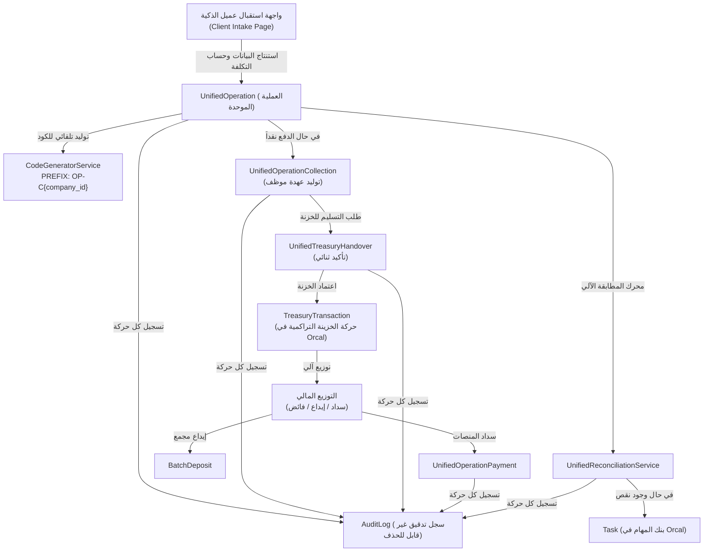

# دليل ومنطق التطبيق الهندسي للنظام الموحد للخدمات والعمليات المالية (Orcal Unified Operations Logic)

> **الهدف الأساسي:** تطبيق المنطق التشغيلي والمحاسبي المعتمد في وثيقة «المخطط الكامل للنظام الموحد للخدمات والعمليات المالية» كمنظومة أعمال متكاملة داخل نظام **Orcal** (Laravel 12 + Filament v5)، **بشكل أصيل ومترابط مع قواعد بيانات وخدمات النظام القائمة، وليس مجرد نسخ لكود واجهات الموك-أب (Mockup).**

---

## 1. جوهر اللوجيك التشغيلي والمالي (Business Engine Logic)

النظام لا يعامل الخدمة كمعاملة منفصلة عن المال، ولا يعامل المال كقيد محاسبي معزول عن الخدمة، بل يربطهما في **محرك موحد (Unified Engine)** يقوم على القواعد التالية:

### 1.1 قاعدة البدء والذكاء في استنتاج البيانات (Context Inference)
* **المبدأ:** "لا يُطلب من المستخدم إعادة إدخال معلومة يستطيع النظام استنتاجها من صاحب الخدمة أو الجهة أو نوع الخدمة."
* **تسلسل التحديد:**
  1. اختيار العميل (مؤسسة أو فرد).
  2. إذا كان العميل **مؤسسة**: يفحص النظام نوع الخدمة:
     - إذا كانت الخدمة تخص المنشأة (مثل: تجديد سجل تجاري، رخصة بلدية، رخصة عمل عامة) -> المستفيد هو المنشأة مباشرة.
     - إذا كانت الخدمة تخص فرداً/عاملاً تابعاً للمؤسسة (مثل: إصدار/تجديد إقامة، نقل كفالة، تأشيرة خروج وعودة) -> النظام يعرض **حصراً** قائمة موظفي/مكفولي هذه المؤسسة، ويمنع إنشاء المعاملة بدون تحديد المستفيد بدقة.
  3. اختيار الخدمة -> يسترجع النظام تلقائياً: الجهة الحكومية، التكلفة والرسوم المتوقعة، الأوراق والمستندات الإلزامية للمطابقة، ومسار العمل الافتراضي.

---

### 1.2 منطق تحديد مسؤولية التكلفة (Cost Responsibility Matrix)
أي معاملة تنشأ يجب أن تُصنف مالياً إلى أحد 4 مسارات:
1. **العميل دفع (`client_paid`):** تحصيل مباشر (كاش أو تحويل) يبدأ دورة العهدة النقدية.
2. **دين على العميل (`client_debt`):** المعاملة تنفذ، وتنشأ فاتورة استحقاق / مديونية على العميل تُتابع آلياً حتى التحصيل، دون تعطيل تنفيذ الخدمة.
3. **على المكتب (`office`):** يتحملها المكتب كنفقة تشغيلية (التزام على المكتب وليس ديناً على العميل).
4. **تكلفة مشتركة (`shared`):** تقسيم القيمة بين العميل والمكتب داخل نفس العملية (مثال: رسوم حكومية 1000 ريال يتحمل العميل 700 ريال والمكتب 300 ريال).

---

### 1.3 منطق انتقال الذمة والعهدة المالية (Custody & Treasury Handover)
* **لحظة القبض (Collection):**
  - بمجرد استلام الموظف للمال من العميل (نقداً أو على حسابه) -> **يسجل النظام المبلغ فوراً كـ "عهدة نقدية" بذمة الموظف**.
  - تظهر العهدة فوراً في شاشة الموظف، ويُرسل إشعار للخزنة بوجود نقد معلق في الميدان.
* **التسليم والتأكيد الثنائي (Two-Way Handover Verification):**
  - لمنع إنكار الاستلام أو فقدان السيولة، يتم التسليم بآلية توثيق مزدوجة: الموظف يطلب التسليم برقم العملية والمبلغ، ومسؤول الخزنة يؤكد الاستلام الفعلي.
  - **النقطة المفصلية:** في اللحظة التي تضغط فيها الخزنة "تأكيد الاستلام":
    1. **تسقط العهدة فوراً عن الموظف المستلم.**
    2. **تنتقل المسؤولية الجنائية والمالية رسمياً إلى عهدة الخزنة.**
    3. **تُنشأ تلقائياً حركة خزنة رسمية في جدول `treasury_transactions` بالرصيد التراكمي.**

---

### 1.4 منطق التوزيع المالي الآلي (Financial Allocation)
بمجرد دخول المال إلى الخزنة، يقوم المحرك بفرز المبلغ آلياً:
* **مخصص السداد (`to_payment`):** الرسوم الحكومية أو الميدانية تُحجز وتتاح لمسؤول السداد لتنفيذها.
* **مخصص الإيداع (`to_deposit`):** الأتعاب أو المبالغ المخصصة للبنك تُحجز لمسؤول الإيداع.
* **الفائض المالي (`excess_amount`):** إذا استلم الموظف مبلغاً زائداً عن التكلفة المتوقعة، لا يختفي ولا يضيع في إيرادات عامة؛ بل يُقيد كـ **"فائض أمانات مرتبط بنفس رقم العملية"** في الخزنة ولا يصرف إلا بقرار.

---

### 1.5 منطق السداد والإيداع والتسويات (Settlement & Deposits)
* **السداد الحكومي:** مسؤول السداد يدفع عبر سداد / مدى / بطاقة الشركة ويرفع الإثبات ورقم الإيصال.
* **السداد الشخصي من الموظف:**
  - إذا اضطر موظف لدفع رسوم معاملة من جيبه الخاص، لا تسجل كمصروف مباشر؛ بل تُسجل كـ **"سداد شخصي بانتظار الاعتماد"**.
  - بعد مراجعة الإثبات واعتماده من المشرف/الإدارة، يُدرج المبلغ تلقائياً في حساب الموظف كـ **"مستحق للموظف واجب الصرف"**.
* **الإيداع المجمع (Batch Deposit Engine):**
  - مسؤول الإيداع قد يودع في البنك دفعة واحدة بقيمة 50,000 ريال تغطي 15 معاملة لـ 10 عملاء مختلفين.
  - المحرك يتيح إنشاء إيصال إيداع بنكي واحد، مع توزيع وتفكيك المبلغ آلياً على كل عملية وعميل ورقم معاملة دون اختلاط الأرصدة.
* **المبالغ المعلقة / المجهولة (Suspense Amounts):**
  - الحوالات البنكية غير المعروفة تُقيد مؤقتاً كـ "مبلغ معلق"، ويقترح النظام العمليات المحتملة لها، ولا ترحل نهائياً إلا بعد اعتماد المشرف.

---

### 1.6 محرك المطابقة الثنائية وتتبع النواقص (Reconciliation Engine)
هذا هو العقل الرقابي للنظام:
* يقوم بفحص 4 محاور:
  1. هل الخدمة تم تنفيذها؟
  2. هل المبلغ المسدد يطابق المتوقع تماماً (دون فروقات)؟
  3. هل يوجد إثبات / مستند رسمي معتمد ومرفوع؟
  4. هل الطرف المقابل مسجل ومطابق؟
* **المبدأ الجوهري (عدم التعطيل وتحديد المسؤول المقصر):**
  - إذا انتهت الخدمة ولكن المستند لم يرفع -> لا يُعاقب ولا يُعطل مسؤول السداد أو الموظف، بل يولد النظام **مهمة آلية فورية في بنك المهام لمسؤول المستند**.
  - إذا وجد فرق مالي -> يُحدد الجزء المسؤول عن الفرق ويُفتح له مهمة استكمال أو تسوية.
  - الموظف الذي أنجز مسؤوليته بنجاح يظل تقييمه مكتملاً 100%، وتنتقل المتابعة لمن بعهدته النقص.

---

### 1.7 شجرة الحالات الـ 13 ومنع التلاعب
* **الحالات:** `new`, `in_progress`, `custody`, `treasury`, `settlement`, `remaining`, `pending_amount`, `mismatched`, `awaiting_approval`, `escalated`, `later_settlement`, `completed`, `cancelled`.
* **قاعدة الإلغاء الصارمة:** طلب الإلغاء لا يسقط العهدة النقدية ولا يحذف أي سجل مالي سابق. لا تلغى العملية إلا بقرار إداري مكتوب يوضح مصير الأموال المستلمة والمصروفة.
* **سجل التدقيق (Audit Log):** كل ضغطة زر، انتقال حالة، اعتماد، رفض، أو سداد، تُسجل بحساب المستخدم، الوقت، المبلغ، والسبب في سجل محمي غير قابل للحذف أو التعديل برمجياً.

---

## 2. كيف نطبق هذا اللوجيك بشكل أصيل في Orcal (Laravel 12 + Filament v5)؟

بدلاً من بناء تطبيق معزول، سنقوم بدمج هذا المحرك داخل بنية Orcal الحالية عبر العناصر التالية:

### 2.1 قواعد البيانات ونماذج Eloquent
1. **`UnifiedOperation`**: الكيان الأساسي للعملية (مع حصر الشركات `company_id` وحقول التكلفة والمطابقة).
2. **`UnifiedOperationCollection`**: تحصيلات العهد والمبالغ المستلمة من العملاء.
3. **`UnifiedTreasuryHandover`**: حركات التسليم والاستلام بين الموظف والخزنة.
4. **`UnifiedOperationPayment`**: سدادات المنصات، السداد الشخصي للموظف، وإثباتات الدفع.
5. **`UnifiedBatchDeposit` & `UnifiedBatchDepositItem`**: دفعات الإيداع البنكي المجمع لعدة عمليات.
6. **`UnifiedAuditLog`**: سجل التدقيق المحمي من الحذف عبر Eloquent Booting (`deleting => return false`).

---

### 2.2 طبقة الخدمات المتخصصة (`app/Services/Unified/`)

تنفيذاً لقواعد `AGENTS.md` بعدم وضع منطق الحسابات في واجهات Filament:

1. **`UnifiedOperationService`**:
   - `createOperation(array $payload)`: التحقق من المستفيد، حساب أنصبة التكلفة (العميل والمكتب)، توليد الكود الرسمي، وحفظ الحالة الأولية.
   - `requestCancellation(UnifiedOperation $op, string $reason)`: إدارة طلب الإلغاء وحظر الإلغاء التلقائي إذا كانت هناك عهد معلقة.
   - `escalateToManagement(UnifiedOperation $op, string $reason)`: تصعيد العوائق للإدارة.

2. **`UnifiedTreasuryService`**:
   - `recordCollection(UnifiedOperation $op, float $amount, string $method)`: قيد العهدة على الموظف وتحديث رصيده.
   - `handoverToTreasury(array $collectionIds, float $amount, string $verifyCode)`: إنشاء إشعار التسليم.
   - `confirmTreasuryReceipt(UnifiedTreasuryHandover $handover)`: التحقق، إسقاط عهدة الموظف، قيد حركة الخزنة في `TreasuryTransaction` بحساب الشركة المحدد، وتشغيل التوزيع المالي.

3. **`UnifiedSettlementService`**:
   - `executeDisbursement(UnifiedOperation $op, float $amount, string $channel, $proofFile, bool $isSelfPaid)`: معالجة السداد وتوثيقه.
   - `approveSelfPaidExpense(UnifiedOperationPayment $payment)`: قيد المبلغ كـ مستحق للموظف قابل للصرف.
   - `processBatchDeposit(string $bank, string $reference, array $operationAllocations, $proofFile)`: تنفيذ الإيداع البنكي المجمع وربطه بالعمليات.

4. **`UnifiedReconciliationService`**:
   - `reconcile(UnifiedOperation $op)`: فحص التطابق الرباعي وحساب الفروقات.
   - `syncDeficiencyTasks(UnifiedOperation $op)`: في حال نقص المستند أو السداد أو الطرف المقابل، ينشئ النظام تلقائياً سجلاً في جدول `tasks` القائم في Orcal ويسنده للموظف المعني مع تاريخ استحقاق محدد.

---

### 2.3 واجهات Filament v5 (الأصلية والمعيارية)

1. **صفحة استقبال عميل (`ClientIntakePage`)**:
   - واجهة ذكية واحدة تتيح للموظف كتابة رقم الهوية أو السجل التجاري -> يسترجع النظام المؤسسة والتابعين -> يختار الخدمة -> يحسب المبالغ -> ينشئ العملية والسند فوراً.
2. **شاشة عرض تفاصيل العملية (`ViewUnifiedOperation`)**:
   - عرض مسار التدفق التفاعلي (المراحل بالألوان المعتمدة: أزرق، بنفسجي، سماوي، برتقالي، أخضر، أحمر).
   - بطاقات التكلفة والمبالغ المسددة والمتبقية وسجل التدقيق الزمني.
   - أزرار الإجراءات السريعة (تحصيل، تسليم للخزنة، رفع إثبات، تصعيد، إلغاء).
3. **لوحة استلام الخزنة (`TreasuryHandoversTab`)**:
   - جدول يوضح العهد المعلقة في ذمة كل موظف وتأكيد الاستلام الفعلي لنقل المسؤولية للخزنة.
4. **شاشة المطابقة والنواقص (`ReconciliationView`)**:
   - تصنيف العمليات حسب نوع النقص (فرق مالي، مستند ناقص، طرف مقابل مفقود) مع متابعة حالة كل مهمة.
5. **لوحتي كموظف (`EmployeeMyWorkspace`)**:
   - توضح لكل موظف ما بذمته من عهد، وما يستحقه من مبالغ دفعها شخصياً، والمهام المسندة إليه.

---

### 2.4 الطباعة والسندات عبر mPDF
- استخدام إعدادات الطباعة المعتمدة في Orcal (`autoArabic = true`, `direction = rtl`, font: `dejavusans`).
- إصدار:
  * سند قبض تحصيل مع رمز الاستجابة السريعة (QR) موضحاً رقم العملية والخدمة والمستفيد.
  * إشعار تسليم واستلام عهدة الخزنة بتوقيع الطرفين.
  * بطاقة أرشفة العملية والمطابقة النهائية.
