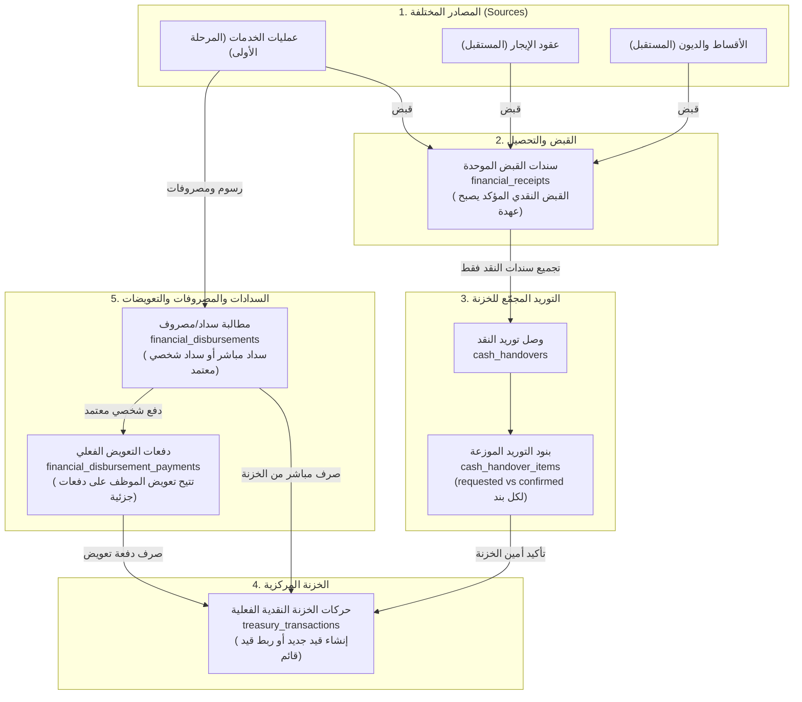

# خطة الدورة المالية الموحدة والعملية في Orcal (الإصدار المطور)
## (Unified Practical Financial Workflow Plan)

- **التاريخ:** 11 نوفمبر 2026
- **المسار:** `docs/plans/codex/ORCAL_PRACTICAL_FINANCIAL_WORKFLOW_PLAN_AR.md`
- **الهدف الأساسي:** تأسيس دورة مالية مركزية موحدة، قابلة للتعميم على كافة عمليات المنظومة (الخدمات، العقود، الأقساط، الديون) دون إعادة اختراع العجلة، وتغطي بدقة الحالات التشغيلية الواقعية (التوريد الجزئي الموزع، التعويضات المتعددة، فصل الفائض عن المخصصات، والربط الآمن بالخزنة دون تكرار القيود).

الخدمات والمتابعة أول وحدة للتفعيل. أمثلة الموكاب أدناه توضح القبض والعهدة والتوريد والتوزيع والسداد الشخصي. اختبارات التزامن والتحويل والمطابقة المقترحة تخص تنفيذ Orcal. في الطلب الحالي، التوريد هو دخول النقد إلى خزنة مقدم الخدمة. إيداع البنك مرحلة مستقلة في الموكاب، وتحتاج طلبًا ونطاقًا محددين لتفعيلها في المشروع. [نتائج تجربة الموكاب بالأدوار](C:/Users/mma/.codex/visualizations/2026/11/10/01a1c59a-4ccc-7572-ac4d-d8ef3d4b5560/MOCKUP_FINANCIAL_WORKFLOW_TRIAL_RESULTS_AR.md).

---

## 1. فلسفة التصميم ومعيار النجاح للتعميم

1. **التعميم الواقعي (Pragmatic Generalization):**
   - **العمود الفقري موحد:** مسارات حركة المال الأساسية (القبض ← عهدة النقد ← توريد الخزنة ← الصرف والتعويض) تظل مشتركة بين كافة الموديولات عبر جداول عامة متعددة الأشكال (`Polymorphic Sources: source_type, source_id`).
   - **خصوصية كل وحدة في موصلها:** عند إضافة وحدة جديدة (كالعقود أو الإيجارات)، ينصب العمل على تحديد مستندات تلك الوحدة وقواعد استحقاقها وربطها بالدورة المشتركة.
   - **التطوير المرن عند الحاجة:** لا ندعي "عدم تعديل قاعدة البيانات إطلاقاً"؛ فإذا تطلبت وحدة جديدة لاحقاً حالة خاصة (مثل دفعة واحدة تسدد أقساطاً متعددة)، يتم توسيع الجداول أو إضافة جدول بنود مخصص لتلك الحالة دون المساس بالهيكل المشترك المستقر.

---

## 2. التدفق المالي العام ومعالجة الحالات الميدانية

---

## 3. نموذج البيانات المطور (Schema Definition)

يتكون النموذج من **3 جداول رئيسية + جدولي بنود وتفصيل للمدفوعات الجزئية**:

### الجدول 1: سندات القبض والتحصيل الموحدة (`financial_receipts`)
* `id`
* `company_id` + `branch_id` (نطاق وصلاحيات الشركة)
* `source_type` + `source_id` (Polymorphic). استخدم اسمًا ثابتًا من قائمة مسجلة في الخادم. المفعّل أولًا `service_transaction`. تُحمّل المعاملة من نطاق الشركة والفرع وتُفحص صلاحية الإجراء عليها قبل الحفظ.
* `receipt_number`: كود تسلسلي فريد من `CodeGeneratorService`
* `request_key`: مفتاح فريد لمنع تكرار الإرسال (Idempotency)
* `collector_employee_id`: الموظف المحصل. العهدة النقدية تخص السند المؤكد بطريقة `cash` فقط.
* `payer_name`: اسم العميل أو الدافع
* `amount`: المبلغ المقبوض (`decimal(14,2)`)
* `payment_method`: (`cash`, `bank_transfer`, `pos`)
* `status`: (`pending_confirmation`, `confirmed`, `reversed`). القبض قيد التحقق يظهر في السجل وتُحتسب قيمته بعد التأكيد.
* `reference_number` + `proof_path`: رقم الإيصال أو الحوالة وصورة المرفق
* `destination_type` + `destination_reference`: نوع الجهة المستلمة ومرجع الوجهة المعتمدة في الشركة عند التحويل أو الشبكة. الحقول صريحة لأنها تحدد المسار المالي. سجّل `confirmed_by` و`confirmed_at` بعد التحقق.
* `received_at`: تاريخ ووقت الاستلام الفعلي
* `notes` + `created_by`
* `metadata`: حقل JSON مرن واحتياطي لحفظ أي بيانات تكميلية أو مخصصة تخص المصدر (مثل رقم الشيك، تفاصيل البنك، بيانات الدافع الإضافية)

---

### الجدول 2: وصولات توريد النقد للخزنة (`cash_handovers`)
* `id`
* `company_id` + `branch_id`
* `handover_number`: كود تسلسلي فريد
* `request_key` لطلب إنشاء الوصل و`confirmation_key` لتأكيده. احفظ هوية الطلب ونتيجته لكل إجراء.
* `collector_employee_id`: حامل العهدة صاحب السندات. `delivered_by_employee_id`: من سلّم فعليًا. في المسار الأول يجوز أن يكونا نفس الشخص. إن سلّم شخص آخر، تُحفظ هويته ويُتحقق من تفويضه، وتظل العهدة على حاملها حتى التأكيد. نقل العهدة بين موظفين إجراء مستقل يحتاج اعتماد قواعده.
* `received_by`: مستخدم الخزنة الذي أكد الاستلام، من الجلسة المصرح لها.
* `total_requested_amount`: إجمالي المبلغ المطلوب توريده في الوصل
* `total_confirmed_amount`: إجمالي المبلغ المستلم فعلياً في الخزنة
* `difference_amount`: الفارق (عجز أو زيادة إن وجد)
* `status`: (`submitted`, `confirmed`, `rejected`, `cancelled`)
* `treasury_transaction_id`: معرف قيد الخزنة الفعلي المرتبط (Nullable Unique)
* `requested_at` + `confirmed_at`
* `notes` + `rejection_reason`
* `metadata`: حقل JSON مرن واحتياطي لحفظ بيانات إضافية (مثل أرقام أكياس التوريد، ملاحظات العد، تفاصيل تسليم العهدة)

### الجدول 2-مكرر: بنود التوريد الموزعة (`cash_handover_items`)
> **حل مشكلة التوريد الجزئي المجمع:** يتيح معرفة المبلغ المستلم لكل سند على حدة عند حدوث فرق في العد.
* `id`
* `cash_handover_id`: الوصل التابع له
* `financial_receipt_id`: سند القبض المورد
* `company_id` مفهرس، ويطابق الشركة على السند والوصـل. اجعل علاقة الوصل بالسند فريدة داخل نفس الوصل، وطبّق النطاق والصلاحيات على الاستعلامات عن البنود.
* `requested_amount`: المبلغ المطلوب توريده من هذا السند
* **`confirmed_amount`**: المبلغ المستلم الفعلي المنسوب لهذا السند بعد مراجعة الخزنة (Default: 0)
* `metadata`: حقل JSON مرن واحتياطي لحفظ بيانات تدقيق أو تفاصيل السند وقت التسليم
* `created_at` + `updated_at`

---

### الجدول 3: مطالبات السداد والمصروفات (`financial_disbursements`)
* `id`
* `company_id` + `branch_id`
* `source_type` + `source_id`
* `disbursement_number`: كود فريد
* `request_key`: مفتاح منع تكرار تسجيل السداد. اعتماد المطالبة يُحمى بقفلها وفحص انتقال الحالة وحفظ المعتمد والتوقيت.
* `disbursement_type`:
  - `treasury_direct`: صرف مباشر من الخزنة لجهة خارجية.
  - `employee_personal`: دفع شخصي من جيب الموظف للجهة، يطلب تعويضه.
* `amount`: إجمالي المبلغ المصروف للجهة
* `beneficiary_name`: الجهة المستفيدة (جوازات، مرور، بلدية، مكتب خارجي...)
* `reference_number` + `receipt_proof`: إيصال السداد ومرفقه
* `status`:
  - المباشر: `paid`.
  - الشخصي: `pending_approval` → `approved` → `partially_reimbursed` → `fully_reimbursed`.
* `paid_by_employee_id`: الموظف الدافع شخصياً
* `approved_by` + `approved_at`: المشرف المعتمد للمطالبة
* `treasury_transaction_id`: قيد الخزنة في حال الصرف المباشر الفوري (Nullable Unique). طلب السداد الشخصي واعتماده يثبتان الالتزام، والتعويض من الخزنة يرتبط بجدول دفعات التعويض.
* `notes` + `created_by`
* `metadata`: حقل JSON مرن واحتياطي لحفظ بيانات الخدمة، أرقام الفواتير الحكومية، أو أي تفاصيل خاصة بالمطالبة

### الجدول 3-مكرر: دفعات التعويض الفعلي للموظف (`financial_disbursement_payments`)
> **حل مشكلة التعويض الجزئي على دفعات:** يوثق كل دفعة تعويض مالية منفصلة وقيدها في الخزنة.
* `id`
* `financial_disbursement_id`: ربط بالمطالبة الشخصية المعتمدة
* `company_id` مفهرس ويطابق المطالبة والقيد، و`branch_id` عند انطباقه.
* `payment_number`: كود فريد لسند التعويض
* `request_key`: مفتاح منع تكرار دفعة التعويض. افحص المتبقي بعد قفل المطالبة وقبل إنشاء قيدها.
* `amount`: المبلغ المصروف في هذه الدفعة (`decimal(14,2)`)
* `treasury_transaction_id`: قيد صادر الخزنة الفعلي لهذه الدفعة (Unique)
* `paid_by`: المستخدم الصارف (أمين الخزنة)
* `paid_at`: تاريخ ووقت الصرف
* `notes`
* `metadata`: حقل JSON مرن واحتياطي لحفظ بيانات التحويل أو طريقة التعويض للموظف

---

## 4. القواعد المحاسبية للحالات التشغيلية الدقيقة

### أولاً: قاعدة التوريد الجزئي المجمع (Partial Batch Handover)
- عند إنشاء وصل توريد لمبلغ 200 ريال (100 لسند خدمة أ + 100 لسند خدمة ب):
  - ينشأ بندان في `cash_handover_items` بقيمة `requested_amount = 100` لكل منهما.
- إذا عَدّ أمين الخزنة النقد واستلم 150 ريالاً فقط:
  - يُثبت أمين الصندوق في الواجهة توزيع الـ 150: (100 لسند خدمة أ، و 50 لسند خدمة ب).
  - يُحفظ في البنود: البند الأول `confirmed_amount = 100`، والبند الثاني `confirmed_amount = 50`.
  - **الأثر المحاسبي:** عهدة الموظف على السند (أ) تصبح صفر، بينما السند (ب) يبقى منه 50 ريالاً كعهدة نقدية مستمرة على المحصل حتى يوردها في وصل لاحق.
- طلب التوريد يحجز المبلغ من قابلية إنشاء وصل آخر. اجمع السندات المؤكدة لنفس حامل العهدة والشركة ونطاق الخزنة، واقفل صفوف السندات بترتيب ثابت عند إنشاء أو تأكيد الوصل. العهدة والنقد يتغيران عند التأكيد. الإلغاء أو الرفض قبل التأكيد يحرر الحجز. عند تأكيد جزئي يُحرر حجز الجزء غير المستلم حتى يمكن توريده لاحقًا.
- عند التأكيد، يساوي مجموع البنود المؤكدة مبلغ النقد المنسوب للسندات. لا تتجاوز قيمة البند المؤكدة المطلوب أو عهدة السند المتاحة. إذا زاد العد عن المبلغ القابل للنسب للسندات، يسجل الفرق ومحضر العد والمسؤول ويُحال للتسوية وفق صلاحيات الخزنة. عند وجود مال زائد فعليًا، يُحدد مكانه وقيده كفرق معلق عند الاعتماد، ولا يزيد تحصيل العميل تلقائيًا. نقص العد لا يسقط باقي عهدة السند ولا ينشئ خصمًا على الموظف.

### ثانياً: قاعدة التعويض الجزئي للموظف (Partial Reimbursement)
- دفع الموظف 150 ريالاً واعتمدها المشرف:
  - ينشأ سجل في `financial_disbursements` بمبلغ 150 وحالة `approved`.
  - `المستحق الإجمالي للموظف = 150`.
- قامت الخزنة بصرف 50 ريالاً كدفعة أولى:
  - ينشأ سجل في `financial_disbursement_payments` بمبلغ 50 ويرتبط بقيد صادر خزنة واحد.
  - تتغير حالة المطالبة إلى `partially_reimbursed`.
  - معادلة رصيد الموظف:
    $$\text{المتبقي للموظف} = \text{المبلغ المعتمد} - \sum(\text{دفعات التعويض المسجلة}) = 150 - 50 = 100 \text{ ريال}$$
- يظل الموظف يطالب بـ 100 ريال، وتظل الواجهة تتيح زر «صرف تعويض» بالمبلغ المتبقي حتى يكتمل سداد كامل المبلغ وتتحول الحالة إلى `fully_reimbursed`.

### ثالثاً: قاعدة فصل المخصصات والفائض والمتبقي (Allocations vs Surplus)
في مثال الموكاب، خدمة قيمتها 1,200 ريال، والمقبوض النقدي 1,300، والخزنة أكدت استلامه كله. التوزيع أظهر 1,200 للسداد و100 فائض. سُجل سداد 600 وأظهرت المطابقة فرق 600، وظل السداد في حالة «مسجل» في التجربة. في Orcal يدخل المبلغ في المسدد الفعلي بعد تحقق الإثبات واعتماد الحالة المطلوبة لمسار السداد. الأرقام التالية تفترض أن دفعة الـ600 أصبحت مؤكدة وصُرفت فعلًا من الخزنة.
يتم الفصل الرياضي الصريح في شاشة المعاملة بين 3 أوعية مستقلة:
1. **استحقاق الرسوم الحكومية (Gov Fee Allocation):**
   - المتوقع للجهة: 1,200 ريال.
   - المسدد الفعلي بإثباتات: 600 ريال.
   - **المتبقي للجهة:** $1,200 - 600 = 600 \text{ ريال}$ (مطلوب سدادها).
2. **استحقاق العميل والتحصيل:**
   - المطلوب من العميل: 1,200 ريال.
   - المقبوض الفعلي: 1,300 ريال.
   - **المتبقي على العميل:** 0 ريال (مسدد بالكامل).
3. **فائض العميل المعلق (Client Surplus):**
   - **الفائض المحتجز:** $1,300 - 1,200 = 100 \text{ ريال}$ فائض صريح ومسجل لنفس المعاملة، لا يبتلعه رصيد الخزنة، ولا يخصم عشوائياً من دين آخر إلا بقرار رسمي معتمد.

**حفظ المخصص في التفعيل الأول:** مخصص رسوم واحد لكل معاملة خدمة، يحفظ ضمن لقطة مالية على `ServiceTransaction`، بحقول واضحة مثل `financial_workflow_version` و`client_due_amount` و`expected_fee_amount` و`fee_beneficiary_reference` و`terms_approved_by` و`terms_approved_at`. يجوز استعمال حقل قائم بعد التحقق من أن دلالته مطابقة. `default_gov_fee` اقتراح من تعريف الخدمة، وإقرار القيمة مسؤولية صاحب الصلاحية. الصفر المعتمد يعني أن الخدمة بلا رسوم، والقيمة الفارغة تعني نقص تحديد القاعدة. التعديل بعد تسجيل حركات له إجراء تصحيح مع سبب وتدقيق. إذا اعتمدت خدمة عدة مخصصات مستقلة لكل منها جهة أو مسؤول أو دفعات خاصة، يُصمم جدول بنود وقت اعتماد تلك الحالة.

- **استحقاق العميل:** احسب الباقي من نصيب العميل المعتمد ناقص ما طُبق من القبض المؤكد. احسب الفائض من المقبوض المؤكد الذي تجاوز ما يطبق على الاستحقاق. اربط الفائض بالسند الأصلي وبمكان المال. يمكن الاستفادة من `UnifiedSuspenseAmount` للتحقيق والتسوية بتمييز نوع «زائد معلوم المصدر». إعادة تخصيص زائد سبق قبضه لا تضيف دفعة قبض.
- **استحقاق الجهة:** المتوقع المعتمد ناقص السداد الفعلي المؤكد من الخزنة والسداد الشخصي المعتمد لنفس الجهة، بعد العكس. دفعة التعويض لا تحسب مرة ثانية سدادًا للجهة.
- **تمويل السداد من الصندوق:** استخدم صافي النقد المؤكد المنسوب لهذه المعاملة والمطبق على استحقاقها، بعد استبعاد الفائض المحجوز وأي مبالغ بغير الصندوق. اطرح الصرف المباشر والتعويضات المنفذة من نفس التمويل. احجز في المتبقي قدر المستحق الشخصي المعتمد غير المعوض إذا كان يُموّل من نفس المال. المخصص المتاح للجهة هو الأقل بين استحقاقها المتبقي والنقد المتاح بعد هذا الحجز. لا يعتبر الحجز صرفًا. أي تمويل من المكتب خارج قبض العميل يحتاج مصدرًا معتمدًا قبل إدخاله في الحساب.
- في المثال بعد الصرف المؤكد 600 يكون باقي مخصص الجهة الممول 600، والفائض المحجوز 100، وصافي أثر هذه العملية على نقد الصندوق 700. إذا أكدت الخزنة توريد 200 فقط من قبض 400، فإن حد التوزيع الممول نقدًا 200. بقية القبض تُتابع حسب مكانها وعهدتها.

### رابعاً: قاعدة منع تكرار القيد القائم (Safe Treasury Linkage)
- حدد جهة واحدة تكتب كل قيد. عند تأكيد توريد أو صرف جديد، اكتب المستند والقيد وربطهما والتدقيق داخل `DB::transaction()` واحدة. في وحدة لها قيد قائم، أعد تحميل القيد من المستند الأصلي بعد القفل، وتحقق من الشركة والاتجاه والمبلغ والمرجع والصلاحية، وأن القيد يعود لهذا الأثر فعلًا. نفس القيمة أو نفس الشركة وحدهما لا يثبتان العلاقة. حفظ الرابط بقيد قائم يبقي رصيد الخزنة كما هو.
- اقفل صف القيد عند الربط، وافحص ارتباطه عبر المسارات الثلاثة التي تحفظ `treasury_transaction_id`، وعبر أي مسار مالي سابق مفعّل. تفرد الحقل داخل جدول واحد يحمي ذلك الجدول فقط. ارفض إعادة نسبة القيد لحدث آخر، واسمح باستعلام السجل المرتبط بنفس الأثر. يُحدد الخادم نوع المصدر من قائمة معتمدة، ويطبق الشركة والفرع والسياسة على المستند والقيد قبل الربط.
- في التحصيل وطلب التوريد وتأكيده والسداد والتعويض، كرّر قراءة الحالة تحت القفل ثم احفظ الطلب وقيده في معاملة واحدة. تحقق من مفاتيح فريدة ضمن الشركة ونوع الأمر. تكرار نفس المفتاح ونفس البيانات يعيد نتيجة التنفيذ الأصلي. نفس المفتاح مع مبلغ أو بنود مختلفة يرفض. مفاتيح الطلب ليست بديلًا عن التحقق أن نفس المستند أو الوصل لم يُرحّل بالفعل.
- رصيد `TreasuryTransaction.balance_after` الحالي يقرأ آخر حركة للشركة. قفل الوصل وحده لا يسلسل حركتين لوصلين مختلفين. على المنفّذ جرد كتاب الخزنة ومراجعة أي خدمة ترحيل موجودة. استخدم قفلًا مشتركًا لنطاق الصندوق وبترتيب ثابت للموارد، أو طريقة حساب رصيد معتمدة ومتكاملة مع الكتاب الحاليين. التحقق على MySQL معزولة يشمل واردًا وصادرًا متزامنين من مصدرين مختلفين. اعتماد التفعيل المالي يتوقف على ثبوت سلامة هذا المسار مع الكتاب الموجودين.
- العكس المعتمد يسجل حركة مرتبطة بالأصل ويحدث المتبقي والمهام. تأكد من أن عكسًا معادًا أو جزئيًا لا يتجاوز صافي الحدث. أرسل التنبيهات بعد نجاح المعاملة.

### خامساً: التحويل والشبكة

الموكاب أظهر وسائل قبض متعددة، والتجارب المثبتة على العهدة والتوريد كانت نقدية. في Orcal، التحويل أو الشبكة يسجلان بمبلغ ومرجع وإثبات ووجهة معتمدة للشركة، مثل حساب استقبال معرف أو جهاز شبكة مربوط بوجهة فعلية. يتحقق المسؤول من وصول المبلغ للوجهة قبل التأكيد. إذا لم توجد وجهة معتمدة، يبقى السند قيد التحقق. السند المؤكد غير النقدي يقلل استحقاق العميل ويظهر في التحصيل غير النقدي. لا يدخل قائمة توريد النقد ولا يزيد عهدة المحصل أو نقد الصندوق. رد المبلغ أو نقله بين الحسابات إجراءات تحتاج مستندًا خاصًا عند طلبها. اختبار هذه الحالة منفصل عن إيداع البنك بعد الخزنة.

### سادساً: المطابقة والإغلاق ومسؤول النقص

استخدم `OperationsReconciliationService::evaluate()` كنقطة دخول للمطابقة، بمسار للمعاملات المفعّلة على السجلات الجديدة. تحسب الخدمة المبالغ من السندات والقيود المعتمدة، وتعيد الحالات والأرقام ومعرفات الأدلة. امنع `ServiceTransaction::saving()` من إعادة كتابة النتيجة بقواعد مختلفة للمسار الجديد. استمر في قراءة السجلات القديمة حسب سلوكها القائم إلى أن يعتمد ترحيلها.

| الفحص | الدليل | المسؤول عند النقص |
| --- | --- | --- |
| قبض العميل | الطرف والمستحق والسند المؤكد، والمبلغ المطبق. الدين المعتمد أو حصة المكتب تظهر كاستثناء موثق وفق القاعدة | المحصل أو مسؤول متابعة العميل |
| النقد والعهدة | مجموع البنود المؤكدة يطابق القيد الوارد، وتظل العهدة غير الموردة ظاهرة | المحصل قبل إرسال الوصل، والخزنة عند انتظار التحقق أو التأكيد |
| رسوم الجهة عند انطباقها | لقطة الرسوم والجهة، وسداد مؤكد مطابق بالمرجع والمبلغ والإثبات. الخدمة بلا رسوم لا تتطلب إيصال رسوم | مسؤول السداد |
| السداد الشخصي والتعويض | إثبات الدفع الشخصي واعتماده، والتعويضات المؤكدة وصافي المستحق | المشرف للاعتماد، والخزنة للتعويض |
| الفروق والفائض | فرق موثق له أصل وموقع ومسؤول وقرار معتمد. يبقى المعروض من الرصيد حتى تسويته | مسؤول معالجة الفروق أو المشرف |

لا يطلب مسار التوريد النقدي إيصال إيداع بنكي افتراضيًا. تنتهي مسؤولية الشخص عند إتمام مرحلته، وتظل المعاملة المالية مفتوحة عند وجود نقص مطلوب حسب قاعدة الخدمة. تابع مستحق الموظف منفصلًا حتى صرفه. إغلاق مهمة يدويًا لا يغطي نقصًا ماليًا ما دام سببه قائمًا. استخدم حارس إغلاق يعيد التقييم عند الإجراء، وحدث أو أغلق مهمة النقص عند تغير المبلغ أو الإثبات، مع مفتاح ثابت يمنع تكرارها. تُرسل التنبيهات لمسؤول المرحلة المعين بصلاحية ونطاق صحيحين وبمبلغ الحدث المؤكد. إذا أكد الصندوق 200 من أصل قبض 400، يكون تنبيه الاستلام بـ200. إذا غاب المسؤول، تظهر مهمة تعيين للمشرف.

---

## 5. خطة التنفيذ المعتمدة (الخدمات كأول موديول)

### قبل أول Migration

توجد في الـworkspace محاولة سابقة للمحرك العام. ملف `database/migrations/2026_11_11_100000_create_shared_financial_engine_tables.php` يعرّف `financial_receipts` بمخطط مختلف عن هذا الملف، وتوجد له موديلات وخدمة `FinancialTreasuryPostingService`. لذلك ابدأ بجرد التعديلات الحالية وقراءة مخطط قاعدة الاختبار وسجل الـmigrations المصرح به. وجود الملف محليًا لا يثبت أنه اتشغّل أو اتنشر.

- إذا كانت المحاولة السابقة غير منشورة، قدّم تغييرًا مركزًا لتسوية التعارض والحفاظ على الأجزاء القابلة لإعادة الاستخدام، مع مراجعة تغييرات المستخدم. لا تضف migration ثانية تنشئ `financial_receipts` بجانب الأولى.
- إذا كان المخطط السابق مطبقًا، استخدم migration إضافية توافقية أو خطة انتقال تُراجع على نسخة اختبار. لا تغيّر migration منشورة، ولا تحذف سجلات أو جداول مالية لمجرد اختيار هذا التصميم. راجع أيضًا migrations بتاريخ `2026_11_08` التي تبدأ بعض عملياتها بـ`dropIfExists` لجداول التدقيق والنواقص والإيداعات. جرب المخطط على قاعدة معزولة قبل أي نشر.
- الهدف اعتماد مسار كتابة واحد لكل أثر مالي. اختر إعادة استعمال مكون قائم بعد فحصه أو كتابة المسار المباشر المقترح، وسجّل القرار وحدود تشغيله في دليل الوحدة. لا يُشغّل المساران على المستند نفسه. ترحيل البيانات التاريخية والنشر لهما نطاق منفصل.

### المرحلة 1: الجداول المركزية ومسار القبض والتوريد المجمع
1. تجهيز ملف Migration للجداول الموحدة (`financial_receipts`, `cash_handovers`, `cash_handover_items`, `financial_disbursements`, `financial_disbursement_payments`).
2. أضف لقطة الشروط المالية للعمليات الجديدة. افصل استحقاق العميل والرسوم عن القبض، وامنع ملء `paid_amount` عند اختيار السعر أو من يتحمل التكلفة. واجهة المسار الجديد تعرض المدفوع من السندات المؤكدة للقراءة. الفاتورة والدين التابعان لنفس العملية يرتبطان بنفس القبض، ويُفحص تحديث ملخصاتهما من دون إنشاء حركة نقد إضافية. السجلات القديمة تحافظ على مسار القراءة الموثق.
3. أضف Action «تسجيل سند قبض». يدعم النقد، ويؤكد التحويل أو الشبكة عند توفر وجهة وإثبات وصلاحية وفق القسم 4.5. اختيار نوع الدفع من الواجهة وحده لا يؤكد القبض.
4. إضافة Action لتوريد العهدة: `طلب توريد نقد للخزنة` (يحدد السندات الموردة ومبالغها).
5. شاشة الخزنة: `استلام وتأكيد النقد` (تتيح لأمين الصندوق تعديل المبلغ المستلم لكل بند، وتوليد قيد الخزنة الوارد، وتخفيض عهدة المحصل بدقة).
6. طبّق ضوابط نطاق الشركة والفرع والتكرار في خدمة الكتابة، واختبر وصولات جزئية متزامنة وربط قيد قائم. استبعد أي مسار سابق يستطيع تأكيد نفس السند مرة أخرى عند تفعيل السجل الجديد.

### المرحلة 2: السداد والدفع الشخصي والتعويض الجزئي
1. إضافة Action: `تسجيل سداد رسوم` (مباشر من الخزنة أو دفع شخصي من الموظف).
2. إضافة Action للمشرف: `اعتماد سداد شخصي` (يثبت سداد الرسوم للجهة ويظهر رصيداً مستحقاً للموظف).
3. إضافة Action لأمين الخزنة: `صرف دفعة تعويض لموظف` (يدعم السداد الكامل أو الجزئي، وينشئ قيد صادر خزنة لكل دفعة، ويحدث رصيد الموظف المتبقي).
4. اربط كل دفعة بلقطة الرسوم والجهة وبالمخصص الممول. أظهر المطلوب غير الممول منفصلًا. افحص تمويل المصروف ورصيد الصندوق وصافي المستحق تحت القفل. سجل الفرق في التكلفة أو إثبات السداد محل المراجعة عند عدم تطابقهما. تأكد أن 600 ثم 400 تُحفظان كدفعتين متتاليتين وأن التعويض بعد الدفع الشخصي لا يزيد سداد الجهة مرة ثانية.

### المرحلة 3: كارت الملخص والمطابقة والتنبيهات
1. بناء `ServiceFinancialSummaryWidget` في صفحة المعاملة يوضح الأوعية بوضوح:
   - (المطلوب | المقبوض | عهدة المحصل | الوارد للخزنة | مخصص الرسوم | المسدد | المتبقي للسداد | المستحق للموظف | الفائض).
2. إطلاق التنبيهات للأدوار المعنية (المشرف للاعتماد، أمين الخزنة للتوريد، المحصل للنواقص) عبر `NotificationDispatcher`.
3. نفّذ المطابقة الفعلية من السندات ومبالغها حسب القسم 4.6. حدّث حارس الإغلاق ومهام النقص في مسار الخدمات، واختبر حالة بلا رسوم، وحالة فيها فرق مالي مع وجود إثبات. حوّل مكان كتابة نتيجة المطابقة إلى الخدمة الواحدة للمسار الجديد.
4. أضف قائمة انتظار وصولات التوريد لمسؤول الخزنة، ومطلوب السداد لمسؤوله، والمطالبات والتعويضات والفروق لأصحابها. استخدم مفاتيح متطابقة في `lang/ar` و`lang/en`، وراجع صلاحية المستلم عند إرسال التنبيه بعد الحفظ وعند معالجة Queue.
5. بعد إثبات الخدمات، يحدد المستخدم الوحدة التالية. عند ضمها، حدد المصدر والقيود القائمة والإجراءات المطلوبة، واستعمل الجداول والخدمات المناسبة لنفس النوع من الحركة. تصميم الوحدة الجديدة يتحدد بعد قراءة مسارها الحالي واختباره.

---

## 6. مصفوفة اختبارات القبول الرقمية (Feature Test Cases)

| # | اسم الاختبار | السيناريو والإجراء | النتيجة الإلزامية المتوقعة |
| :--- | :--- | :--- | :--- |
| **1** | **توريد جزئي مجمع** | وصل يجمع 100 لمعاملة أ + 100 لمعاملة ب. الخزنة استلمت 150 (100 لأ، و 50 لب). | قيد وارد بـ 150. معاملة أ عهدتها 0، معاملة ب عهدتها المتبقية 50. لا فقدان لأي مبلغ. |
| **2** | **تعويض جزئي** | مطالبة شخصية معتمدة بـ 150 ريال. الخزنة صرفت دفعة 50 ريال. | قيد صادر خزنة بـ 50. المستحق المتبقي للموظف = 100 ريال. تظل المطالبة مفتوحة برصيد 100. |
| **3** | **فائض وتخصيص** | مطلوب ورسوم معتمدة 1,200، قبض نقدي مؤكد 1,300 واستلامه كاملًا بالخزنة، ثم صرف مؤكد 600 للجهة. | المتبقي على العميل 0، والفائض المحتجز 100، والمخصص الممول المتبقي 600، وصافي نقد هذه العملية 700. |
| **4** | **منع تكرار الوصل** | طلب تأكيد الوصل مرتين متزامنتين بنفس المفتاح والبنود. | تنفيذ التأكيد مرة واحدة وقيد واحد، والطلب الثاني يعيد النتيجة نفسها. اختلاف البيانات مع نفس المفتاح يُرفض. |
| **5** | **ربط قيد قائم** | ربط قيد موثق من المستند الأصلي ثم محاولة ربطه بمستند آخر. | الربط الصحيح يحافظ على الرصيد. المستند الآخر أو اختلاف المبلغ أو الاتجاه يُرفض، ولا يُنشأ أي قيد إضافي. |
| **6** | **عزل الشركات** | محاولة أمين خزنة من شركة أ تأكيد وصل يتبع لشركة ب. | رفض فوري 403 Forbidden بناءً على `CompanyAccessScopeService`. |
| **7** | **تمويل جزئي** | استحقاق 1,000، قبض 400، توريد مؤكد 200 فقط. | المتبقي على العميل 600، وعهدة المحصل 200، ووارد الصندوق 200، والممول من هذا التوريد أقصاه 200. |
| **8** | **تحويل أو شبكة** | قبض 400 إلى وجهة معتمدة مع إثبات. افحص قبل التأكيد وبعده. | بعد التأكيد يزيد تحصيل العميل 400، والنقد والعهدة صفر. بدون وجهة متحقق منها يظل معلقًا. |
| **9** | **الصادر المتكرر** | إعادة طلب سداد أو دفعة تعويض مؤكدة بالمفتاح نفسه. | قيد صادر واحد، وتُحتسب الدفعة مرة واحدة. مطالبة 150 وتعويض 50 تبقي 100 حتى الطلب التالي الصحيح. |
| **10** | **تزامن حركتين مختلفتين** | افتتاحي 1,000، وارد 200 وصادر 100 من مصدرين على نفس الصندوق بالتزامن. | قيدان، ورصيد نهائي 1,100، ورصيد كل قيد متسق مع ترتيب ترحيله. يشمل الاختبار كاتبًا قديمًا عند وجوده في نفس الخزنة. |
| **11** | **المطابقة حسب الخدمة** | خدمة بلا رسوم مكتملة الإثباتات، وخدمة رسوم مطلوبها 1,200 ودُفع 600 بإثبات. | الأولى تطابق وفق شروطها دون إيصال رسوم أو بنك افتراضي. الثانية تبقى مفتوحة بفرق 600 عند مسؤول السداد. |
| **12** | **تنبيه التوريد والفروق** | قبض 400 وتوريد مؤكد 200، ثم إعادة الطلب. | إشعار واحد بقيمة 200 للمعني. العهدة الباقية 200. المسؤول الذي أنهى التسليم لا يتلقى نقص سداد ليس من دوره. |
| **13** | **فشل منتصف الحفظ وعكس** | افشل كتابة القيد بعد إنشاء المستند داخل المعاملة، ثم نفذ مثال عكس معتمد بعد نجاح دفعة أخرى. | الفشل لا يترك أثرًا ماليًا نصف محفوظ أو إشعارًا. العكس يعيد المتبقي ويربط القيد المقابل بالأصل دون تعديل تاريخه. |

هذه اختبارات قبول مقترحة للتنفيذ. في مرحلة الكود شغّل `php -l` وPint للملفات المتغيرة وFeature Tests على قاعدة معزولة، واختبر التزامن على MySQL. افحص الإدخال والنتيجة من Filament، وامسح كاش الواجهات بعد تعديل Blade. حدّث دليل الوحدة والفهرس والمرجع المشترك وسجل التغييرات والمشكلات ضمن التنفيذ وفق AGENTS.md. النشر يدوي، ويشمل `php artisan optimize:clear` بعد الرفع.
