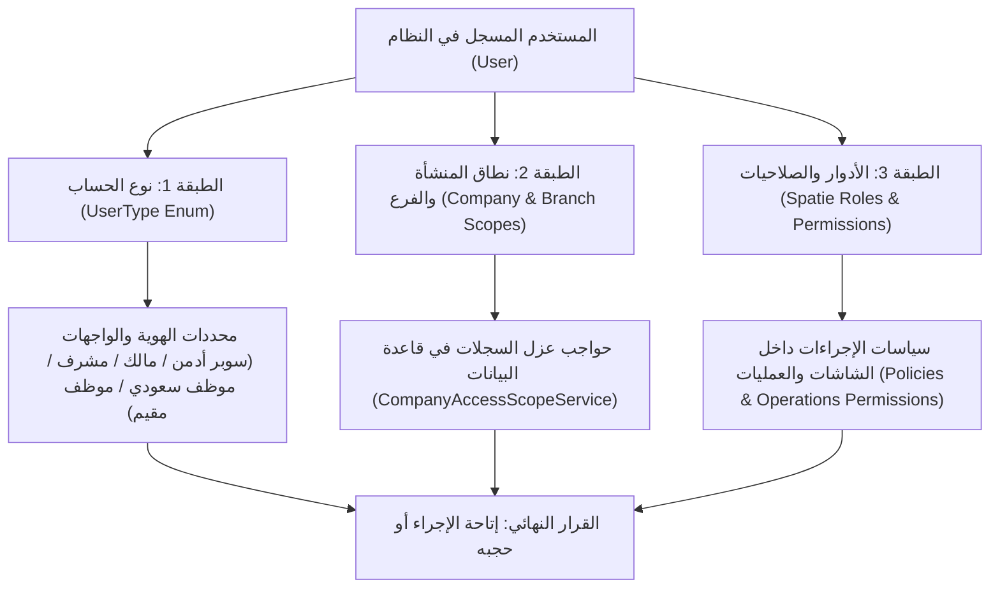
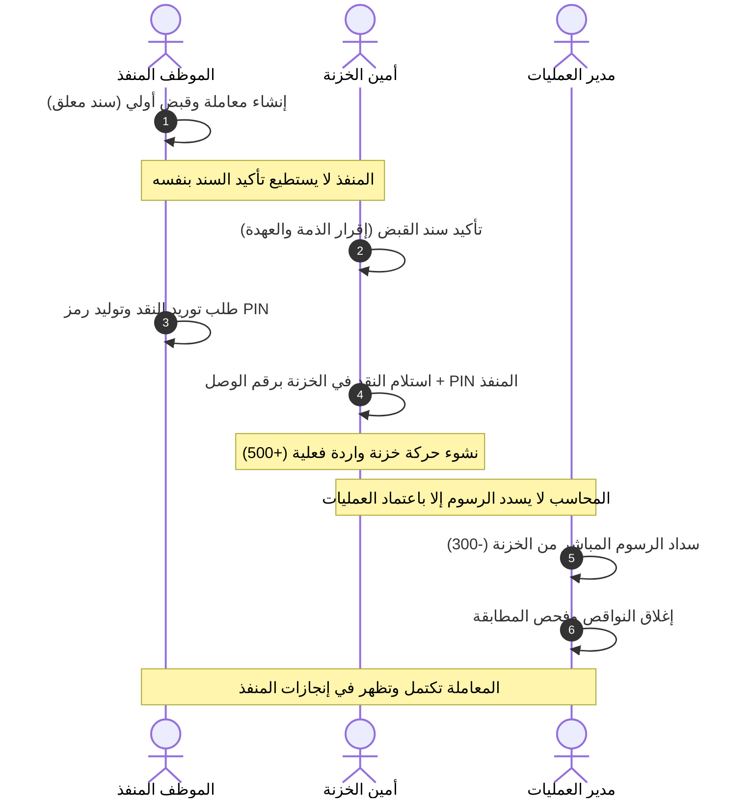

# دليل ومصفوفة صلاحيات الموظفين والأدوار في نظام أوركال (الدليل الرقابي والتشغيلي الشامل)

**آخر مطابقة للكود المحلي:** 2026-11-12.  
**المشروع المعتمد:** `D:\company projects\orcal from server`.  
**الملف المرجعي المقارن:** [سيناريو اختبار الخدمات وأداء الموظف من الصلاحيات (UAT)](file:///d:/company%20projects/orcal%20from%20server/docs/plans/codex/ORCAL_SERVICES_AND_EMPLOYEE_PERFORMANCE_UAT_AR.md).

---

## 1. مقدمة وإطار الحوكمة والصلاحيات

يقوم نظام **أوركال (Orcal Management System)** على منظومة أمنية ورقابية متعددة الأبعاد تهدف إلى حماية التدفقات المالية، ضبط مسارات المعاملات والخدمات، منع تضارب المصالح (Segregation of Duties - SoD)، وضمان خصوصية وعزل البيانات بين المنشآت المتعددة والفروع.

تتكون صلاحيات أي موظف أو مستخدم داخل النظام من تداخل **ثلاث طبقات أمنية متزامنة**:



1. **الطبقة الأولى: نوع الحساب (`UserType` Enum):** يحدد طبيعة المستخدم الأساسية في شجرة النظام (`super_admin`, `admin`, `supervisor`, `saudi_employee`, `foreign_employee`, `owner`).
2. **الطبقة الثانية: نطاق الوصول وعزل الشركات والفروع (`CompanyAccessScopeService` + `HasCompanyScope`):** يحدد أي سجلات في قاعدة البيانات يسمح للاستعلام بجلبها وعرضها للمستخدم، بغض النظر عن امتلاكه صلاحية العرض العامة.
3. **الطبقة الثالثة: الأدوار والصلاحيات التشغيلية (`Spatie Permission` + `Policies` + `OperationsPermissionService`):** يحدد الأزرار، الشاشات، والإجراءات الملموسة التي يستطيع المستخدم النقر عليها وتنفيذها (عرض، إنشاء، تعديل، حذف، اعتماد، قبض، توريد، سداد، تصعيد).

---

## 2. محددات العزل ونطاق البيانات (Scopes & Multi-Company Architecture)

قبل تقييم ما إذا كان الموظف يملك زر الإجراء، يُطبّق محرك العزل التلقائي `CompanyAccessScopeService::apply()` القواعد التالية على أي استعلام:

| حالة المستخدم | نطاق البيانات المتاح له | القيد الرقابي المطبق |
| --- | --- | --- |
| **مدير النظام الخارق (Super Admin)** | جميع الشركات، جميع الفروع، كافة السجلات بلا استثناء. | يمر عبر `HasSuperAdminBypass`. |
| **مالك / شريك (Owner)** | مقتصر حصراً على الشركات التي يملك حصة فيها مسجلة بجدول `owners` (`getOwnedCompanyIds()`). | لا يرى أي سجل أو حركة أو موظف تابع لشركة لا يملكها. |
| **موظف مقيد بفرع (`branch_id` موجود ولا يملك `view_any_branch`)** | مقتصر على فرعه المعين فقط داخل شركته المصرح بها. | لا تظهر له سجلات الفروع الأخرى في نفس الشركة. |
| **موظف غير مقيد بفرع (معين على مستوى المنشأة/الإدارة العامة)** | جميع فروع شركته المصرح له بها، أو الشركات المشتركة لقسمه العام (`is_global`). | متاح له فروع شركته فقط وليس شركات النظام الأخرى. |
| **مستخدم بلا شركات مصرح بها وبلا فرع** | **حجب كامل** — النتيجة استعلام فارغ (`1 = 0`). | النظام لا يعتبر القائمة الفارغة وصولاً مفتوحاً أبداً. |
| **مشرف نوبة (`UserType::SUPERVISOR`)** | موظفو المنشأة المشمولون في نوبة عمل نشطة أو مكتملة تابعة له (`SupervisionShift`). | لا يرى أداء موظفين خارج فريقه، ولا يرى فترات زمنية خارج تواريخ النوبة. |

---

## 3. الدليل التفصيلي لكل دور وموظف في المنظومة

فيما يلي تحليل دقيق وشامل للأدوار العشرة الأساسية في النظام، يحدد الشاشات، ما يستطيع الموظف فعله، ما يُمنع منه قطعاً، ونقاط تسليمه مع زملائه.

---

### الدور 1: الموظف المنفذ / الموظف العادي (Regular / Executing Employee)
* **المسمى في النظام:** `موظف` | **نوع الحساب:** `saudi_employee` أو `foreign_employee`.
* **الهدف الوظيفي:** استقبال طلبات العملاء، فتح المعاملات وتنفيذها ميدانياً أو إدارياً، متابعة المهام المسندة له وإنجازها الشخصي.
* **موقع الدخول في النظام:**
  * القائمة الجانبية ← **لوحتي** (شاشته المستقلة لمتابعة الأداء والنواقص والتكليفات).
  * المالية العامة والخدمات ← **الخدمات والمتابعة**.
  * المهام والملاحظات ← **المهام** (أو **سجل مهامي** للسعوديين).
  * شؤون الموظفين ← **طلبات الإجازات** (تقديم طلب شخصي) و**تذاكر الدعم**.

#### 1. ما يستطيع فعله بالتفصيل (الصلاحيات الممنوحة Can Do):
1. **إنشاء وتسجيل المعاملات:** فتح معاملة خدمة جديدة (`create_service_transaction`)، وتحديد المستفيد، ونوع الخدمة والتكلفة.
2. **تسجيل سند القبض الأولي عند الإنشاء (`record_service_receipt`):** يستطيع تفعيل خيار «استلمت من العميل عند الإنشاء» وتسجيل المبلغ كـ «سند قبض بانتظار التأكيد».
3. **طلب توريد النقد للخزنة (`request_cash_handover`):** بعد أن يتأكد سند القبض، يمكنه استخراج «وصل توريد نقد» من المعاملة، وتوليد **رمز وصول التوريد** وكود التوقيع السري الخاص به المكون من 4 أرقام (PIN).
4. **تصعيد المعاملات المتعثرة (`escalate_service_transaction`):** رفع المعاملة لمدير العمليات عند وجود عقبة إدارية أو نظامية تتطلب تدخل الإدارة.
5. **متابعة أدائه الشخصي في «لوحتي»:** فحص مؤشراته الشخصية (الخدمات الجارية، المكتملة، المتأخرة، والنواقص الرقابية المفتوحة عليه).
6. **تقديم الإجازات والتذاكر:** تقديم طلب إجازة شخصية (`create_leave`) وإنشاء تذكرة دعم فني (`create_ticket`).

#### 2. ما يُمنع منه قطعاً (خطوط الدفاع والرقابة Cannot Do):
* **القبض النقدي:** يُحتسب عند التسجيل بصلاحية `record_service_receipt` ويصبح عهدة على المحصل. تأكيد السندات المعلقة وعكس سند القبض يتطلبان `confirm_service_receipt`.
* ❌ **ممنوع من استلام النقد في الخزنة:** لا يملك صلاحية `confirm_cash_handover`؛ لا يستطيع إبراء ذمة نفسه من العهدة النقدية.
* ❌ **ممنوع من السداد المباشر من الخزنة:** لا يملك `record_service_disbursement`؛ لا يستطيع سحب مبالغ الرسوم من الخزنة المركزية.
* ❌ **ممنوع من تغيير المعاملة إلى مكتملة يدويًا:** إذا كان بالمعاملة نواقص مالية أو رسوم لم تسدد، ترفض واجهة النظام إغلاقها.
* ❌ **ممنوع من رؤية أداء زملائه أو ملفاتهم:** لا يملك صلاحيات `view_any_saudi_employee` أو `view_any_foreign_employee` ولا يرى إلا بياناته في «لوحتي».

#### 3. مسار التسليم والاستلام (Workflow Handoff):
* **يُسلم إلى:** أمين الخزنة (يسلمه النقد المحصل يداً بيد مع رقم وصل التوريد وكود التوقيع المكون من 4 أرقام).
* **يستلم من:** المشرف أو مدير العمليات (يستلم التكليفات والتوجيهات عبر شاشة المهام).

---

### الدور 2: أمين الخزنة / المحاسب المالي (Cashier / Financial Accountant)
* **المسمى في النظام:** `محاسب` أو `محاسب مالي` أو `مدير مالي ومحاسب`.
* **الهدف الوظيفي:** استلام النقد والعهد، ضبط دفاتر اليومية وحركات الخزنة، تأكيد سندات القبض، سداد الرسوم وإجراء الإيداعات البنكية.
* **موقع الدخول في النظام:**
  * المالية والمحاسبة ← **الخزينة وحركات الخزنة** و**استلام وتأكيد النقد**.
  * المالية العامة والخدمات ← **الخدمات والمتابعة** (لتأكيد السندات المعلقة وسداد الرسوم).
  * المالية والمحاسبة ← **قيود اليومية** و**الأقساط والديون** و**أجهزة نقاط البيع**.

#### 1. ما يستطيع فعله بالتفصيل (الصلاحيات الممنوحة Can Do):
1. **تأكيد سندات القبض المعلقة (`confirm_service_receipt`):** تأكيد التحويل أو القبض غير النقدي بعد مراجعة الإثبات، وتأكيد أي سند نقدي معلق من قبل تغيير مسار القبض.
2. **استلام وتأكيد توريد النقد في الخزنة (`confirm_cash_handover`):** فتح شاشة الخزنة، مسح الباركود أو إدخال رقم وصل التوريد، إدخال كود التوقيع (PIN) الخاص بالموظف المسلم، وتأكيد دخول النقد الفعلي للخزنة لإنشاء حركة واردة واحدة (`+Amount`).
3. **تسجيل الحركات المالية في الخزنة (`create_treasury_transaction`):** قيود الإيداع والسحب والصرف والتحويل بين الخزائن.
4. **صرف تعويضات الموظفين المعتمدة (`pay_employee_reimbursement`):** صرف المستحقات المعتمدة للموظف الذي دفع رسوماً من جيبه الشخصي، وتوليد سند صرف جزئي أو كلي.
5. **إدارة الإيداعات البنكية المجمعة والحوالات المعلقة (`manage_batch_deposits`, `manage_suspense_amounts`):** معالجة الفروقات النقدية والحوالات غير المطابقة.
6. **اعتماد سندات سداد الأقساط والديون (`approve_installment_payment`, `approve_debt_collection`).**

#### 2. ما يُمنع منه قطعاً (خطوط الدفاع والرقابة Cannot Do):
* ❌ **الحذف معطل برمجياً بالكامل:** دالة `TreasuryTransactionPolicy::delete` تعيد `false` دائماً. لا يستطيع أمين الخزنة ولا المحاسب حذف أي حركة خزنة مسجلة؛ التصحيح يتم حصراً بقيد عكسي معتمد (`reverse_financial_transaction`).
* ❌ **ممنوع من تأكيد التوريد دون رمز توقيع الموظف:** يرفض النظام تأكيد استلام النقد إذا كان كود التوقيع المكون من 4 أرقام خاطئاً؛ لحماية أمين الخزنة والموظف معاً من ادعاءات التوريد الوهمي.
* ❌ **ممنوع من تسجيل سداد رسوم من خزنة بلا رصيد كافٍ:** يمنع محرك `FinancialTreasuryService` الحركات التي تجعل رصيد الخزنة سالباً.
* ❌ **ممنوع من تعديل بيانات الموظفين أو رواتبهم الأساسية:** شؤون الموظفين والرواتب التعاقدية محجوبة عن دوره؛ وظيفته تقتصر على صرف المسير المعتمد.

#### 3. مسار التسليم والاستلام (Workflow Handoff):
* **يستلم من:** الموظف المنفذ (يستلم النقد ورمز التوقيع)؛ ومن مدير الموارد البشرية (يستلم مسير الرواتب المعتمد للصرف).
* **يُسلم إلى:** البنك (إيداعات نقدية مجمعة بحساب المنشأة)؛ وإلى الإدارة المالية العليا (موازين المراجعة وكشوف الحساب).

---

### الدور 3: مدير العمليات / مشرف العمليات (Operations Manager / Supervisor)
* **المسمى في النظام:** `مدير عمليات` أو `مشرف عمليات`.
* **الهدف الوظيفي:** الرقابة الشاملة على تنفيذ المعاملات، ضبط الجودة والمطابقة، حل المشكلات المصعدة، واعتماد سداد الرسوم الحكومية والتكاليف.
* **موقع الدخول في النظام:**
  * العمليات والمتابعة ← **لوحة المسار والرقابة التشغيلية** (`view_operational_dashboard`).
  * المالية العامة والخدمات ← **الخدمات والمتابعة** (إجراءات الاعتماد وسداد الرسوم والمطابقة).
  * المهام والملاحظات ← **المهام وتكليفات المهام** و**الملاحظات الأسبوعية**.

#### 1. ما يستطيع فعله بالتفصيل (الصلاحيات الممنوحة Can Do):
1. **استعراض لوحة الرقابة التشغيلية (`view_operational_dashboard`):** متابعة مؤشرات الأداء الحية لكافة المنفذين والمعاملات الجارية والمتأخرة والنواقص.
2. **حل وفك تصعيد المعاملات (`resolve_service_escalation`):** دراسة المعاملات المصعدة من الموظفين وإعادتها للمسار الصحيح.
3. **معالجة وإغلاق مهام النواقص الرقابية (`resolve_deficiency_task`):** إعادة فحص المعاملة عبر `OperationsReconciliationService` للتحقق من زوال مانع الإكمال.
4. **سداد رسوم الخدمات المباشر من الخزنة (`record_service_disbursement`):** تسجيل قيد صرف رسوم المعاملة (مثل سداد منصة قوى/مقيم/بلدي) بعد التحقق من وجود تمويل مؤكد للمعاملة.
5. **اعتماد السداد الشخصي للموظف (`approve_self_paid_disbursement`):** اعتماد مطالبة الموظف الذي دفع رسوم خدمة حكومية من حسابه الخاص لتأهيلها للصرف لدى المحاسب.
6. **تكليف الموظفين بالمهام ومتابعة تقييمها (`create_task_assignment`, `update_task_assignment`).**

#### 2. ما يُمنع منه قطعاً (خطوط الدفاع والرقابة Cannot Do):
* ❌ **ممنوع من إكمال المعاملة دون تسوية مالية كاملة:** يمنع النظام تحويل المعاملة إلى مكتملة طالما بقي عجز في تحصيل العميل أو نقص في سداد الرسوم.
* ❌ **ممنوع من صرف التعويض المالي نقداً بيده:** هو يعتمد المطالبة فقط (`approve`)، بينما الصرف الفعلي من الخزنة اختصاص حصري لأمين الخزنة (`pay_employee_reimbursement`).
* ❌ **ممنوع من الاطلاع على شركات خارج نطاق تكليفه الإداري.**

#### 3. مسار التسليم والاستلام (Workflow Handoff):
* **يستلم من:** الموظفين المنفذين (المعاملات المصعدة ومطالبات السداد الشخصي).
* **يُسلم إلى:** أمين الخزنة (مطالبات التعويض المعتمدة للصرف)؛ وإلى الإدارة العليا (تقارير الإنجاز ونسب النواقص).

---

### الدور 4: مشرف النوبة / الإشراف الميداني (Shift / Field Supervisor)
* **المسمى في النظام:** `مشرف` (مرتبط بنوبة عمل في `supervision_shifts`) | **نوع الحساب:** `supervisor`.
* **الهدف الوظيفي:** الإشراف المباشر على مجموعة عمل محددة ميدانياً أو إدارياً خلال فترة زمنية مجدولة.
* **موقع الدخول في النظام:**
  * لوحة التحكم ← **لوحة المشرف**.
  * شؤون الموظفين ← **ملف الموظف ← تبويب الأداء**.
  * العمليات ← **نوبات الإشراف** و**الملاحظات الأسبوعية**.

#### 1. ما يستطيع فعله بالتفصيل (الصلاحيات الممنوحة Can Do):
1. **متابعة أداء أعضاء فريقه المباشر:** يفتح تبويب «الأداء» لجميع الموظفين المقيدين تحت نوبته النشطة في نفس المنشأة.
2. **استعراض تكليفات وخدمات الفريق:** الاطلاع على بطاقات الخدمات الجارية، التكليفات المنجزة، والمهام المتأخرة لفريقه خلال فترة النوبة.
3. **تدوين الملاحظات الأسبوعية والتوجيهات الميدانية (`create_weekly_note`, `update_weekly_note`).**

#### 2. ما يُمنع منه قطعاً (خطوط الدفاع والرقابة Cannot Do):
* ❌ **ممنوع تماماً من الاطلاع على موظفين خارج فريقه:** تفحص خدمة `EmployeePerformanceAccessService::supervisorCovers()` سجلات نوبات الإشراف؛ وإذا لم يكن الموظف ضمن النوبة يتم حجب سجله فوراً.
* ❌ **ممنوع من استعراض فترات خارج نوبته:** إذا اختار المشرف فترة زمنية سابقة أو لاحقة لتاريخ نوبته المعتمدة، تُحجب أرقام الأداء وتظهر أصفاراً.
* ❌ **ممنوع من أي إجراء مالي:** ليس لديه وصول للخزنة أو تأكيد السندات أو سداد الرسوم.

#### 3. مسار التسليم والاستلام (Workflow Handoff):
* **يستلم من:** مدير الفرع / مدير العمليات جدول نوبة العمل المعتمد والموظفين المسندين له.
* **يُسلم إلى:** إدارة الفرع تقارير وتقييمات أداء أعضاء الفريق وسجلات حضورهم الميداني.

---

### الدور 5: مدير الموارد البشرية (HR Manager)
* **المسمى في النظام:** `مدير موارد بشرية`.
* **الهدف الوظيفي:** إدارة دورة حياة الموظف من التعيين حتى نهاية الخدمة، إدارة العقود، مسيرات الرواتب، الحضور والانصراف، الإجازات، والجزاءات.
* **موقع الدخول في النظام:**
  * شؤون الموظفين ← **الموظفون السعوديون** و**الموظفون المقيمون**.
  * شؤون الموظفين ← **مسيرات الرواتب** و**مكافآت الموظفين** و**الأقساط والسلف**.
  * الحضور والإجازات ← **الحضور والانصراف** و**طلبات الإجازات** و**أنواع الإجازات**.
  * أدوات النظام ← **الأسئلة الشائعة** (إدارة قاعدة المعرفة للموظفين).

#### 1. ما يستطيع فعله بالتفصيل (الصلاحيات الممنوحة Can Do):
1. **إدارة ملفات الموظفين بالكامل:** إنشاء وتعديل بيانات الموظفين السعوديين والأجانب (`create_saudi_employee`, `update_foreign_employee`, ...).
2. **إعداد ومراجعة مسيرات الرواتب (`create_payroll_record`, `update_payroll_record`):** حساب المستحقات والبدلات والخصومات ومسيرات الرواتب الشهرية التفاعلية عبر `PayrollSheetService`.
3. **إدارة واعتماد الإجازات (`change_leave_status`):** قبول ورفض طلبات الإجازات وحساب الأرصدة المستحقة عبر `LeaveSummaryService`.
4. **تسجيل السلف والأقساط والمكافآت:** قيد السلف على الموظفين ومتابعة استقطاعها الآلي من مسير الراتب.
5. **إدارة الأسئلة الشائعة للنظام (`manage_faqs`):** إضافة وتعديل أدلة الاستخدام واللوائح الداخلية.

#### 2. ما يُمنع منه قطعاً (خطوط الدفاع والرقابة Cannot Do):
* ❌ **ممنوع من الصرف المالي الفعلي من الخزنة:** إعداد الراتب في المسير شيء، وصرفه نقداً من الخزنة شيء آخر تماماً؛ الصرف يتطلب دوراً مالياً يسجل حركة الخزنة.
* ❌ **ممنوع من التدخل في فواتير وعقود عملاء المنشأة:** شاشات المقاولات والعقود محجوبة عن اختصاصه.
* ❌ **ممنوع من تعديل حركات الخزنة التاريخية أو القيود المحاسبية العامة.**

#### 3. مسار التسليم والاستلام (Workflow Handoff):
* **يستلم من:** مسؤول الحضور تقرير الغياب والحضور؛ ومن الموظفين طلبات الإجازات والسلف.
* **يُسلم إلى:** الإدارة المالية مسير الرواتب المعتمد لتنفيذ التحويلات البنكية أو الصرف من الخزنة.

---

### الدور 6: مسؤول الحضور والانصراف (Attendance Officer)
* **المسمى في النظام:** `مسؤول حضور وانصراف`.
* **الهدف الوظيفي:** ضبط ومتابعة دوام الموظفين اليومي، معالجة البصمات اليدوية والآلية، وفحص حالات التأخير والغياب.
* **موقع الدخول في النظام:**
  * الحضور والإجازات ← **الحضور والانصراف** (شاشة السجلات وشاشة الملخص التفاعلي).
  * الحضور والإجازات ← **طلبات الإجازات**.
  * شؤون الموظفين ← استعراض الموظفين (لأغراض المتابعة فقط).

#### 1. ما يستطيع فعله بالتفصيل (الصلاحيات الممنوحة Can Do):
1. **تسجيل وتعديل الحضور اليدوي (`create_attendance`, `update_attendance`):** معالجة نسيان البصمة أو الحضور الميداني الاستثنائي.
2. **تشغيل فحص الغياب التلقائي (`check_attendance_absent`):** إطلاق محرك الفحص الآلي لتوليد سجلات الغياب لمن لم يسجلوا حضوراً.
3. **استعراض واعتماد الإجازات:** مراجعة طلبات الإجازات للمطابقة مع جداول الدوام.

#### 2. ما يُمنع منه قطعاً (خطوط الدفاع والرقابة Cannot Do):
* ❌ **ممنوع من تعديل رواتب أو بدلات أو عقود الموظفين.**
* ❌ **ممنوع من إصدار مسير الرواتب الشهري أو تغيير قيم الاستقطاع.**
* ❌ **ممنوع من الوصول لأي شاشة مالية أو تشغيلية تخص الخدمات والخزنة.**

#### 3. مسار التسليم والاستلام (Workflow Handoff):
* **يستلم من:** أجهزة البصمة البيومترية والموظفين إثباتات الحضور والانصراف.
* **يُسلم إلى:** مدير الموارد البشرية كشف الحضور النهائي لإدخاله في معادلات الراتب.

---

### الدور 7: مدير الفرع (Branch Manager)
* **المسمى في النظام:** `مدير فرع`.
* **الهدف الوظيفي:** الإشراف المباشر والشامل على تشغيل الفرع وموظفيه وعملائه وتحقيق مستهدفاته الدورية.
* **موقع الدخول في النظام:**
  * نطاق الفرع المخصص له فقط في كافة الشاشات (الموظفون، الحضور، الإجازات، العملاء، عروض الأسعار، المهام).

#### 1. ما يستطيع فعله بالتفصيل (الصلاحيات الممنوحة Can Do):
1. **إدارة شؤون موظفي الفرع:** متابعة دوامهم، اعتماد إجازاتهم، وتعيين المهام ومتابعة إنجازها.
2. **إدارة علاقات عملاء الفرع:** إنشاء ومتابعة عروض الأسعار والعقود الخاصة بعملاء فرعه (`create_offer`, `update_offer`).
3. **تدوين ومتابعة الملاحظات الأسبوعية للفرع (`create_weekly_note`).**
4. **الاطلاع على خدمات وفواتير الفرع.**

#### 2. ما يُمنع منه قطعاً (خطوط الدفاع والرقابة Cannot Do):
* ❌ **معزول تماماً عن الفروع الأخرى:** لا يستطيع جلب أو استعراض أي موظف أو فاتورة أو حركة تخص فرعاً آخر داخل المنشأة.
* ❌ **ممنوع من تعديل الإعدادات العامة للشركة أو النظام.**
* ❌ **ممنوع من حذف القيود المحاسبية المركزية.**

#### 3. مسار التسليم والاستلام (Workflow Handoff):
* **يستلم من:** الإدارة العامة الأهداف والخطط التشغيلية.
* **يُسلم إلى:** الإدارة العامة تقارير أداء الفرع والإيرادات وعروض الأسعار التي تتطلب موافقة عليا.

---

### الدور 8: مسؤول المقاولات والعقود (Contracts & Invoicing Officer)
* **المسمى في النظام:** `مسؤول المقاولات والعقود`.
* **الهدف الوظيفي:** إدارة المشاريع والعقود التجارية مع العملاء، إصدار المستخلصات الدورية ومتابعة اعتمادها وترحيلها.
* **موقع الدخول في النظام:**
  * المقاولات والعقود ← **العملاء** و**عروض الأسعار والعقود**.
  * المقاولات والعقود ← **الفواتير والمستخلصات** (`ContractVoucher`).
  * المقاولات والعقود ← **تصنيفات العقود**.

#### 1. ما يستطيع فعله بالتفصيل (الصلاحيات الممنوحة Can Do):
1. **إدارة دورة العقد:** تسجيل العميل، إعداد عرض السعر، تحويله إلى عقد رسمي معتمد.
2. **إنشاء المستخلصات وسندات المطالبة (`create_contract_voucher`):** رفع طلبات الدفعات المرحلية بناءً على نسب الإنجاز الميداني.
3. **اعتماد المستخلصات وترحيلها للخزينة (`approve_contract_voucher`):** إقرار المستخلص ليتحول إلى استحقاق مالي رسمي على العميل ويوجه للتحصيل.

#### 2. ما يُمنع منه قطعاً (خطوط الدفاع والرقابة Cannot Do):
* ❌ **ممنوع من قبض النقد في الخزنة المركزية:** وظيفته إصدار واعتماد المستخلص والفوترة، أما قبض النقد فهو اختصاص أمين الخزنة.
* ❌ **ممنوع من الدخول إلى شؤون الموظفين والرواتب والحضور.**
* ❌ **ممنوع من تعديل إعدادات النظام أو الصلاحيات.**

#### 3. مسار التسليم والاستلام (Workflow Handoff):
* **يستلم من:** مهندسي ومديري المشاريع نسب الإنجاز الميدانية للأعمال.
* **يُسلم إلى:** الإدارة المالية والمحاسب المستخلصات المعتمدة لتحصيل مبالغها من العملاء وإصدار قيود اليومية.

---

### الدور 9: مالك الشركة / الشريك (Company Owner)
* **المسمى في النظام:** `مالك` | **نوع الحساب:** `owner`.
* **الهدف الوظيفي:** الإشراف الاستراتيجي والرقابي الأعلى على الشركات المملوكة له، متابعة الأرباح والتدفقات النقدية ومسيرات الرواتب.
* **موقع الدخول في النظام:**
  * لوحات التحكم والتقارير العامة، كشوفات الحسابات المركزية، مسيرات الرواتب، وسجلات الأداء لكافة منشآته.

#### 1. ما يستطيع فعله بالتفصيل (الصلاحيات الممنوحة Can Do):
1. **الوصول الشامل غير المقيد لشركاته:** عبر `HasSuperAdminBypass` و`CompanyAccessScopeService::scopeForOwner()`، يستطيع استعراض كل موظف، معاملة، حركة خزنة، وقيد محاسبي يخص شركاته المسجلة في جدول `owners`.
2. **الاطلاع على تقارير الأرباح والخسائر وكشوفات الخزائن والبنوك.**
3. **متابعة أداء الفروع والمديرين والعمليات في كافة مشاريعه.**

#### 2. ما يُمنع منه قطعاً (خطوط الدفاع والرقابة Cannot Do):
* ❌ **معزول تماماً عن أي شركة أخرى:** محرك `getOwnedCompanyIds()` يعزله تماماً عن أي شركة أو فرع لا يملك فيه حصة ملكية موثقة؛ لا يرى سجلاتها ولا تقاريرها.
* ❌ **ممنوع من ممارسة المعالجة التشغيلية المباشرة:** حساب المالك مخصص للمتابعة والاعتماد الاستراتيجي، وليس لتسجيل البصمات اليومية أو استلام التوريدات كأمين خزنة.

---

### الدور 10: المدير العام ومدير النظام (Super Admin & General Manager)
* **المسمى في النظام:** `Super Admin` أو `مدير عام` | **نوع الحساب:** `super_admin` أو `admin`.
* **الهدف الوظيفي:** إدارة المنظومة بالكامل، إدارة التراخيص والشركات، ضبط حسابات المستخدمين وصلاحياتهم، الرقابة العليا الشاملة.
* **موقع الدخول في النظام:**
  * كافة شاشات وأقسام النظام بلا استثناء، بالإضافة إلى:
  * الإدارة والصلاحيات ← **المديرين وحسابات النظام** و**الأدوار والصلاحيات**.
  * الهيكل التنظيمي ← **الشركات والفروع والأقسام والمسميات الوظيفية**.
  * أدوات متقدمة ← **الاستيراد الذكي (AI)** و**إدارة الترجمات** و**إعدادات النظام العامة**.

#### 1. ما يستطيع فعله بالتفصيل (الصلاحيات الممنوحة Can Do):
1. **الصلاحيات المطلقة عبر النظام:** يملك مصفوفة الصلاحيات كاملة (`$allPermissionNames`) ويتجاوز فلاتر السياسات عبر `HasSuperAdminBypass`.
2. **إنشاء الشركات والفروع والأدوار والمستخدمين.**
3. **تشغيل أوامر الصيانة ومزامنة الصلاحيات التشغيلية (`OperationsPermissionService::syncPermissions()`).**

#### 2. الضوابط الحاكمة حتى على المدير العام (System Invariants):
* 🔒 **عدم حذف حركات الخزنة التاريخية:** سياسة الخزنة `TreasuryTransactionPolicy` تمنع الحذف حتى للمدير العام لضمان عدم وجود فجوات في أرقام وتواريخ كشف الحساب المالي المعتمد للجهات الرقابية والضريبية.

---

## 4. مصفوفة الصلاحيات المتقاطعة الشاملة (Master Permission Matrix)

يوضح الجدول أدناه توزيع الصلاحيات الدقيقة لكل دور وظيفي في المنظومة:

| مجموعة الصلاحيات | اسم الصلاحية البرمجية | موظف منفذ | أمين خزنة / محاسب | مدير عمليات | مشرف نوبة | مدير موارد بشرية | مسؤول حضور | مدير فرع | مسؤول عقود | مالك شركة | سوبر أدمن |
| --- | --- | :---: | :---: | :---: | :---: | :---: | :---: | :---: | :---: | :---: | :---: |
| **العمليات والخدمات** | `create_service_transaction` | ✅ | ❌ | ✅ | ❌ | ❌ | ❌ | ❌ | ❌ | 👁️ | ✅ |
| | `record_service_receipt` | ✅ | ✅ | ✅ | ❌ | ❌ | ❌ | ❌ | ❌ | 👁️ | ✅ |
| | `confirm_service_receipt` | ❌ | ✅ | ✅ | ❌ | ❌ | ❌ | ❌ | ❌ | 👁️ | ✅ |
| | `request_cash_handover` | ✅ | ❌ | ✅ | ❌ | ❌ | ❌ | ❌ | ❌ | 👁️ | ✅ |
| | `confirm_cash_handover` | ❌ | ✅ | ✅ | ❌ | ❌ | ❌ | ❌ | ❌ | 👁️ | ✅ |
| | `record_service_disbursement` | ❌ | ❌ | ✅ | ❌ | ❌ | ❌ | ❌ | ❌ | 👁️ | ✅ |
| | `approve_self_paid_disbursement` | ❌ | ✅ | ✅ | ❌ | ❌ | ❌ | ❌ | ❌ | 👁️ | ✅ |
| | `pay_employee_reimbursement` | ❌ | ✅ | ❌ | ❌ | ❌ | ❌ | ❌ | ❌ | 👁️ | ✅ |
| | `escalate_service_transaction` | ✅ | ❌ | ✅ | ❌ | ❌ | ❌ | ❌ | ❌ | 👁️ | ✅ |
| | `resolve_service_escalation` | ❌ | ❌ | ✅ | ❌ | ❌ | ❌ | ❌ | ❌ | 👁️ | ✅ |
| | `resolve_deficiency_task` | ❌ | ❌ | ✅ | ❌ | ❌ | ❌ | ❌ | ❌ | 👁️ | ✅ |
| | `view_operational_dashboard` | ❌ | ✅ | ✅ | ❌ | ❌ | ❌ | ❌ | ❌ | 👁️ | ✅ |
| **الخزنة والمالية** | `create_treasury_transaction` | ❌ | ✅ | ❌ | ❌ | ❌ | ❌ | ❌ | ❌ | 👁️ | ✅ |
| | `delete_treasury_transaction` | ❌ | ❌ | ❌ | ❌ | ❌ | ❌ | ❌ | ❌ | ❌ | ❌ *(مغلق)* |
| | `manage_batch_deposits` | ❌ | ✅ | ✅ | ❌ | ❌ | ❌ | ❌ | ❌ | 👁️ | ✅ |
| | `manage_suspense_amounts` | ❌ | ✅ | ✅ | ❌ | ❌ | ❌ | ❌ | ❌ | 👁️ | ✅ |
| | `approve_debt_collection` | ❌ | ✅ | ❌ | ❌ | ❌ | ❌ | ❌ | ❌ | 👁️ | ✅ |
| **شؤون الموظفين** | `view_any_saudi_employee` | ❌ | ❌ | ✅ | ⚠️ *(نوبته)* | ✅ | ✅ | ⚠️ *(فرعه)* | ❌ | 👁️ | ✅ |
| | `create_saudi_employee` | ❌ | ❌ | ❌ | ❌ | ✅ | ❌ | ✅ *(فرعه)* | ❌ | 👁️ | ✅ |
| | `view_any_payroll_record` | ❌ | ✅ | ❌ | ❌ | ✅ | ❌ | ❌ | ❌ | 👁️ | ✅ |
| | `create_payroll_record` | ❌ | ❌ | ❌ | ❌ | ✅ | ❌ | ❌ | ❌ | 👁️ | ✅ |
| **الحضور والإجازات** | `view_any_attendance` | ❌ | ❌ | ✅ | ⚠️ *(نوبته)* | ✅ | ✅ | ✅ *(فرعه)* | ❌ | 👁️ | ✅ |
| | `check_attendance_absent` | ❌ | ❌ | ❌ | ❌ | ✅ | ✅ | ✅ *(فرعه)* | ❌ | 👁️ | ✅ |
| | `change_leave_status` | ❌ | ❌ | ❌ | ❌ | ✅ | ✅ | ✅ *(فرعه)* | ❌ | 👁️ | ✅ |
| **العقود والمقاولات** | `create_offer` | ❌ | ❌ | ❌ | ❌ | ❌ | ❌ | ✅ *(فرعه)* | ✅ | 👁️ | ✅ |
| | `create_contract_voucher` | ❌ | ❌ | ❌ | ❌ | ❌ | ❌ | ❌ | ✅ | 👁️ | ✅ |
| | `approve_contract_voucher` | ❌ | ❌ | ❌ | ❌ | ❌ | ❌ | ❌ | ✅ | 👁️ | ✅ |
| **الإشراف والمهام** | `create_task_assignment` | ❌ | ❌ | ✅ | ❌ | ❌ | ❌ | ✅ | ❌ | 👁️ | ✅ |
| | `view_any_weekly_note` | ❌ | ❌ | ✅ | ✅ | ❌ | ❌ | ✅ | ❌ | 👁️ | ✅ |

*الرموز:*  
* ✅ = صلاحية كاملة.  
* ❌ = محجوب تماماً.  
* 👁️ = اطلاع وعرض مالي ورأي بدون تعديل تنفيذي مباشر.  
* ⚠️ = مقيد بشرط خاص (نطاق الفرع أو موظفي نوبة الإشراف).

---

## 5. قواعد الفصل الرقابي الصارم بين المهام (Segregation of Duties)

لحماية منشآت النظام من الأخطاء والاحتيال المالي، تطبق قواعد صارمة تتطلب اشتراك أكثر من طرف لإتمام الدورة الواحدة:



1. **قاعدة اليد الثنائية في القبض والتوريد:**
   * لا يمكن لموظف واحد قبض النقد وتأكيده وتوريده للخزنة بمفرده.
   * الموظف يسجل، والمحاسب يؤكد.
   * الموظف يستخرج رمز PIN السري، وأمين الخزنة يدخل الرمز لاستلام المبلغ في الخزنة.
2. **قاعدة التمويل قبل الصرف:**
   * لا يمكن لمدير العمليات أو المحاسب سداد رسوم حكومية لمعاملة خدمة مباشرة من الخزنة ما لم تكن المعاملة ممولة بسند قبض مؤكد ومورد للخزنة.
3. **قاعدة الفصل في تعويضات الموظفين:**
   * الموظف يسجل «سداد شخصي» ويرفق الإيصال.
   * مدير العمليات أو المحاسب المالي يعتمد صحة المطالبة (`approve_self_paid_disbursement`).
   * أمين الخزنة ينفذ الصرف الفعلي للمبلغ (`pay_employee_reimbursement`).
4. **قاعدة منع تراجع التدقيق (Audit Trail Preservation):**
   * لا يوجد زر لحذف السندات المالية أو حركات الخزنة؛ أي خطأ محاسبي يُعالج بحركة عكسية موثقة باسم المستخدم وتاريخه وسببه.

---

## 6. إجراءات التجهيز والفحص التقني لمسؤول النظام

عند ضبط أو تعديل الصلاحيات لأي مستخدم جديد، يجب على مسؤول النظام اتباع التعليمات التالية:

1. **تعديل صلاحيات الدور:** من «الأدوار والصلاحيات ← المالية العامة والخدمات» اختر الصلاحيات المطلوبة واحفظ الدور. تظهر الصلاحيات المسندة سابقًا محددة عند فتحه، بما فيها القبض والتوريد والسداد.
2. **مزامنة التوزيع الافتراضي (CLI / Tinker):** تُستخدم عند تجهيز الأدوار الافتراضية. لتخصيص دور بعينه، استخدم شاشة الأدوار.
     ```bash
     php artisan tinker --execute="App\Services\OperationsPermissionService::syncPermissions();"
     ```
3. **فحص التحقق السريع لأي مستخدم:**
   * للتأكد من انطباق الصلاحيات على موظف معين برمجياً:
     ```php
     $user = App\Models\User::find($userId);
     // فحص صلاحية العمليات
     Gate::forUser($user)->allows('confirm_cash_handover');
     // فحص نطاق الشركات المتاح للمستخدم
     App\Services\CompanyFormService::getAuthorizedCompanyIds($user);
     ```

---

## 7. الخلاصة وروابط المراجع

يضمن تطبيق هذا الدليل عمل النظام بأعلى درجات الانضباط المالي والشفافية الإدارية؛ حيث يعرف كل موظف مسؤوليته المحددة بدقة، وتتحرك المعاملات بين الموظفين عبر دورات تسليم واستلام محكمة برمجياً.

* **روابط الملفات والسياسات ذات الصلة:**
  * [خدمة الصلاحيات التشغيلية (OperationsPermissionService.php)](file:///d:/company%20projects/orcal%20from%20server/app/Services/OperationsPermissionService.php)
  * [سياسة معاملات الخدمات (ServiceTransactionPolicy.php)](file:///d:/company%20projects/orcal%20from%20server/app/Policies/ServiceTransactionPolicy.php)
  * [سياسة حركات الخزنة (TreasuryTransactionPolicy.php)](file:///d:/company%20projects/orcal%20from%20server/app/Policies/TreasuryTransactionPolicy.php)
  * [خدمة نطاق الشركات (CompanyAccessScopeService.php)](file:///d:/company%20projects/orcal%20from%20server/app/Services/CompanyAccessScopeService.php)
  * [خدمة صلاحيات أداء الموظفين (EmployeePerformanceAccessService.php)](file:///d:/company%20projects/orcal%20from%20server/app/Services/EmployeePerformanceAccessService.php)
  * [دليل الدورة المالية الموحدة (FINANCIAL_WORKFLOW.md)](file:///d:/company%20projects/orcal%20from%20server/docs/modules/FINANCIAL_WORKFLOW.md)
  * [دليل نطاق الشركات والفروع (COMPANY_ACCESS.md)](file:///d:/company%20projects/orcal%20from%20server/docs/modules/COMPANY_ACCESS.md)

